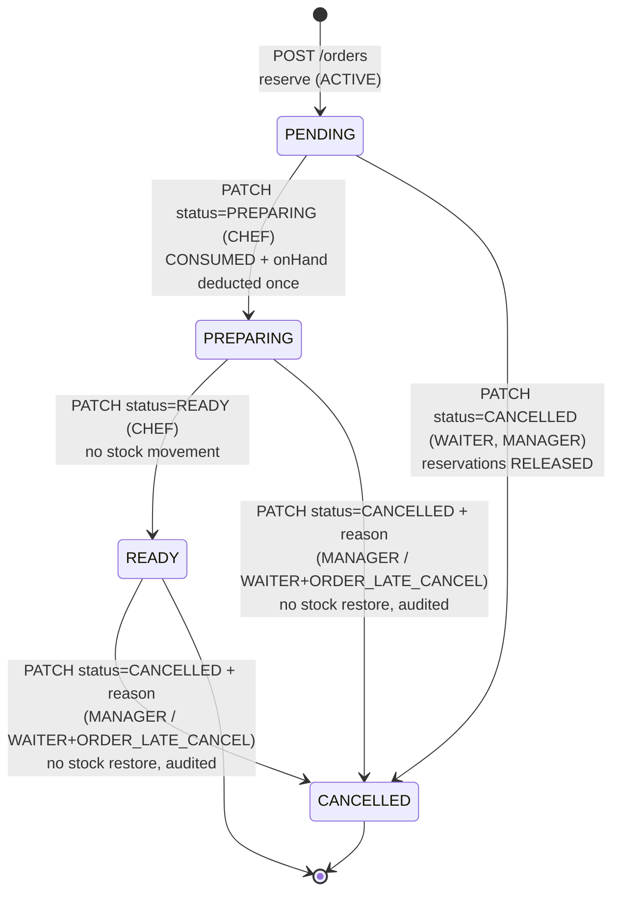

# PantryChef API — OpenAPI Draft (Sprint 1)

| Field | Value |
|---|---|
| Contract | [`api/openapi.yaml`](openapi.yaml) — OpenAPI **3.1.0**, API version `0.1.0` |
| Owner (A/R) | Ayşe Dural — Lead Software Architect and Technical Lead |
| Consulted | Burcu Ücük (requirements), Beyzanur Alpay (testability), Emre Boz (CI), Tuğçe Çevik (integration) |
| Sprint tasks | S1-08, S1-09, S1-10, S1-25 (API part) — see `docs/sprint1-task-board.md` |
| Sources | `docs/project-proposal.md`, `docs/system-vision.md`, `docs/team-roles-raci.md`, decision D-12 |
| Status | Draft — Pending PR Review |

---

## 1. Validation

The contract is validated with [Redocly CLI](https://redocly.com/docs/cli/). The CI job
`OpenAPI lint` (`.github/workflows/ci.yml`) runs the first command below with the repository's
[`redocly.yaml`](../redocly.yaml) on every push and pull request to `main` and `develop`. The
contract is also checked against Redocly's stricter `recommended` ruleset.

```bash
# CI check (repository ruleset)
npx --yes @redocly/cli@2.64.1 lint api/openapi.yaml

# Stricter check (Redocly recommended ruleset)
npx --yes @redocly/cli@2.64.1 lint api/openapi.yaml --extends recommended
```

Result on 2026-11-05: **valid with both rulesets — 0 errors, 0 warnings**, no lint-ignore file.
All request and response examples are validated against their schemas.

| Metric | Value |
|---|---|
| Paths | 23 |
| Operations | 33 |
| Schemas | 51 |
| Parameters | 19 |
| Tags | 10 |

Preview the documentation locally:

```bash
npx --yes @redocly/cli@2.64.1 preview-docs api/openapi.yaml
```

Build a static HTML page (for the Sprint 1 ZIP):

```bash
npx --yes @redocly/cli@2.64.1 build-docs api/openapi.yaml -o pantrychef-api.html
```

---

## 2. Design Conventions

| Topic | Convention |
|---|---|
| Base path | `/v1` (server URL is relative to the host) |
| Authentication | JWT bearer token from `POST /auth/login`; `GET /health` and `POST /auth/login` are public |
| Authorization | Roles `WAITER`, `CHEF`, `MANAGER`; extra permission `ORDER_LATE_CANCEL` (no fourth actor) |
| Resource naming | Plural, kebab-case nouns (`/menu-items`, `/audit-logs`) |
| Status transitions | One endpoint: `PATCH /orders/{orderId}/status` with body `{ "status": …, "reason": … }` |
| Idempotency | `Idempotency-Key` header: **required** on `POST /orders`, optional on `PATCH /orders/{orderId}/status`; replays return `Idempotent-Replayed: true` |
| Errors | RFC 9457 Problem Details (`application/problem+json`) plus a machine-readable `code` |
| Pagination | `page` (from 1) and `size` (1–100, default 20); responses return `{ items, page }` |
| Time | ISO 8601 `date-time` in UTC |
| Units | `g`, `ml`, `piece`; no unit conversion in the MVP |
| Deletion | Users are deactivated (`active: false`); menu items are archived; ingredients are deleted only if unused |

---

## 3. Order Lifecycle in the API



| Request | From | Allowed roles | Success | Typical errors |
|---|---|---|---|---|
| `POST /orders` | — | WAITER, MANAGER | `201` order in `PENDING` | `409 INSUFFICIENT_STOCK`, `422 MENU_ITEM_UNAVAILABLE`, `422 IDEMPOTENCY_KEY_REUSED` |
| `PATCH …/status` `PREPARING` | `PENDING` | CHEF | `200` | `409 INVALID_STATUS_TRANSITION` (also on a repeated start) |
| `PATCH …/status` `READY` | `PREPARING` | CHEF | `200` | `409 INVALID_STATUS_TRANSITION` |
| `PATCH …/status` `CANCELLED` | `PENDING` | WAITER, MANAGER | `200` | `403 FORBIDDEN` (chef) |
| `PATCH …/status` `CANCELLED` | `PREPARING`, `READY` | MANAGER, WAITER + `ORDER_LATE_CANCEL` | `200` | `403 LATE_CANCEL_NOT_PERMITTED`, `422 CANCELLATION_REASON_REQUIRED` |
| any | `CANCELLED` | — | — | `409 INVALID_STATUS_TRANSITION` |

### Stock effects (example: 20 eggs, order needs 5)

| Step | Reservation | `onHand` | `reserved` | `available` |
|---|---|---:|---:|---:|
| Initial | — | 20 | 0 | 20 |
| `POST /orders` → `PENDING` | `ACTIVE` | 20 | 5 | 15 |
| → `PREPARING` | `CONSUMED` | 15 | 0 | 15 |
| → `READY` | `CONSUMED` | 15 | 0 | 15 |
| *(alternative)* `PENDING` → `CANCELLED` | `RELEASED` | 20 | 0 | 20 |
| *(alternative)* `PREPARING` → `CANCELLED` | `CONSUMED` (unchanged) | 15 | 0 | 15 |

---

## 4. Traceability

### 4.1 Functional requirements (`docs/system-vision.md` §13) → operations

| FR | Requirement (short) | Operation(s) |
|---|---|---|
| FR-01 | Authenticated staff roles | `login`, `getCurrentUser`, `bearerAuth`, `Role`, `Permission` |
| FR-02 | Waiters create orders | `createOrder` |
| FR-03 | Ingredient requirements from recipes | `createOrder` (uses current recipe version), `getRecipe` |
| FR-04 | Validate availability before accepting | `createOrder` → `409 INSUFFICIENT_STOCK` with `shortages` |
| FR-05 | Atomic reservation | `createOrder` (all-or-nothing), `Reservation.status = ACTIVE` |
| FR-06 | Pending orders for kitchen | `listOrders?status=PENDING&sort=createdAt` |
| FR-07 | Consume exactly once at preparation | `updateOrderStatus` (`PREPARING`) |
| FR-08 | Mark orders Ready | `updateOrderStatus` (`READY`) |
| FR-09 | Release reservations on Pending cancel | `updateOrderStatus` (`CANCELLED` from `PENDING`) |
| FR-10 | Elevated authorization for late cancel | `updateOrderStatus` → `403 LATE_CANCEL_NOT_PERMITTED` |
| FR-11 | No automatic stock restore after late cancel | `updateOrderStatus` (documented), `createStockAdjustment` for corrections |
| FR-12 | Managers maintain ingredients and recipes | `createIngredient`, `updateIngredient`, `deleteIngredient`, `createMenuItem`, `replaceRecipe` |
| FR-13 | Low-stock monitoring and alerts | `listLowStockAlerts`, `listInventory?lowStock=true`, `InventoryItem.lowStock` |
| FR-14 | Record significant operations | `listStockMovements`, `listAuditLogs`, `Order.statusHistory` |
| FR-15 | Prevent duplicate order submissions | `Idempotency-Key` (required) on `createOrder` |
| FR-16 | Prevent repeated stock deductions | `Idempotency-Key` on `updateOrderStatus`; `409` on repeat |
| FR-17 | Reject invalid transitions | `409 INVALID_STATUS_TRANSITION` |
| FR-18 | Record reason and user for late cancel | `Order.cancellation`, `AuditLogEntry` (`ORDER_LATE_CANCELLED`) |
| FR-19 | Available = Physical − Reserved | `InventoryItem.available`, `listInventory`, `getInventoryItem` |
| FR-20 | Authorized inventory adjustments | `createStockAdjustment` |

### 4.2 Team decisions (`docs/sprint1-meeting-notes.md`) → contract

| Decision | Topic | How the contract reflects it |
|---|---|---|
| D-02 | Reserve during Pending | `createOrder` creates `ACTIVE` reservations; `onHand` unchanged |
| D-03 | Pending cancellation releases reservations | `RELEASED` reservations, `RELEASE` stock movements |
| D-04 | Atomic deduction at Preparing | `updateOrderStatus` (`PREPARING`) — single transaction |
| D-05 | Prevent repeated deduction | `Idempotency-Key` + `409` on repeat |
| D-06 | No deduction at Ready | `updateOrderStatus` (`READY`) — no stock movement |
| D-07 | Preserve recipe version per order | `Recipe.version`, `OrderItem.recipeVersion`, `listRecipeVersions` |
| D-11 | Deduction at Preparing (not Ready) | As D-04 |
| D-12 | Late cancel by Manager / authorized Waiter, audited, no restore | `ORDER_LATE_CANCEL`, mandatory `reason`, `Cancellation`, `ORDER_LATE_CANCELLED` audit entry |
| D-01 | Lifecycle | `PENDING → PREPARING → READY`, or `CANCELLED`; no `DELIVERED` state — see §5, A-1 |

### 4.3 Sprint 1 tasks

| Task | Deliverable in this contract |
|---|---|
| S1-08 Prepare initial OpenAPI YAML | `api/openapi.yaml`, validated (0 errors, 0 warnings) |
| S1-09 Order, inventory and recipe operations | `Orders`, `Inventory`, `Ingredients`, `Recipes`, `Menu Items`, `Reservations` tags |
| S1-10 Errors, idempotency, cancel checks (403/409) | `Problem`, `ErrorCode` (15 codes), `Idempotency-Key`, `403`/`409`/`422` responses |
| S1-25 Late-cancel policy: actor, reason, timestamp, server-side checks | `updateOrderStatus`, `Cancellation`, `AuditLogEntry`, `Permission` |

---

## 5. API Design Decisions and Assumptions

| ID | Decision / assumption | Basis |
|---|---|---|
| A-1 | The order lifecycle ends at `READY`; there is no `DELIVERED` state in the MVP. | Project Proposal §5.1 and §6.6, System Vision §9 and §14.2, the team workflow diagram, `docs/git-workflow.md` §4 and the PR template. Some coordination notes still mention `Delivered`; the API follows the requirements documents. |
| A-2 | Late cancellation (`PREPARING`/`READY` → `CANCELLED`) is allowed for MANAGER and for WAITER with `ORDER_LATE_CANCEL`; `reason` is mandatory; consumed stock is not restored. | Decision D-12 (approved 2026-11-04), System Vision §11 |
| A-3 | Low-stock alerts are read in-app through `GET /inventory/low-stock-alerts`; no email or SMS in the MVP. | System Vision §7.1 and §12.3 (channel not specified) |
| A-4 | Prices are in Turkish lira (TRY). | Single-restaurant MVP (Proposal §9.1) |
| A-5 | Units are `g`, `ml` and `piece`; no unit conversion. | Proposal §9.1, recipe quantities per portion |
| A-6 | Each order item keeps the recipe version used for its reservations. | Decision D-07, RACI §3.9 |

---

## 6. Change Log

| Version | Date | Author | Change |
|---|---|---|---|
| 0.1.0 | 2026-11-05 | Ayşe Dural | Initial Sprint 1 draft; aligned with Proposal, Vision, RACI and D-12 |
