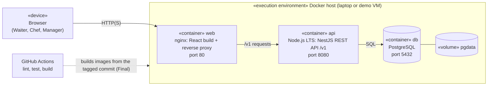

# PantryChef Infrastructure and Deployment Requirements

**Sprint:** Sprint 2
**Task:** S2-23 ([Issue #29](https://github.com/seng321-7th-team/PantryChef/issues/29))
**Owner:** Emre Boz (DevOps and CI/CD)
**Reviewer:** Ayşe Dural
**Status:** Ready for review. The stack and versions follow the architecture decisions (S2-16, `docs/architecture/architecture-decisions.md`, PR #64).

## 1. Purpose

This document describes where and how PantryChef runs: the runtime parts, the environments, the infrastructure requirements and the CI/CD flow. It is the deployment side of the architecture. The C4 diagrams (S2-12, S2-13, S2-34) show what the system is made of; this document shows how those parts are started, configured and kept running.

## 2. Runtime components

| Component | What it does | Notes |
|---|---|---|
| Web frontend | Browser app for Waiter, Chef and Restaurant Manager | React with TypeScript (ADR-001). Built to static files and served by the `web` container. |
| Backend API | Implements [`api/openapi.yaml`](../../api/openapi.yaml) under `/v1`, checks JWT tokens and roles | NestJS with TypeScript on Node.js LTS (ADR-001), one process organised as a modular monolith (ADR-002). Listens on port 8080 in local development (see `servers` in the OpenAPI file). |
| Database | Stores orders, reservations, stock, recipes, users and audit records | PostgreSQL (ADR-001). A supported major version is pinned in Sprint 3 (ADR-011). |
| Reverse proxy | Serves the frontend and forwards `/v1` requests to the backend | nginx in the `web` container, so the browser only talks to one address. Plain HTTP forwarding is enough: the kitchen board polls `GET /v1/orders` every 15 to 30 seconds (team decision, ADR-010), so no WebSocket settings are needed. |

The three containers `web`, `api` and `db` are the same as the containers in the C4 container diagram (S2-13): Web Application, REST API and Database.

## 3. Environments

| Environment | Used for | How it starts | Data |
|---|---|---|---|
| Local | Development on each laptop | `docker compose up` | Seed data, can be reset any time |
| CI | Checks on every pull request | GitHub Actions | Temporary test database, deleted after the run (from Sprint 3) |
| Demo | Sprint demos and the final presentation | `docker compose up` on the demo machine, from the tagged release | Seed data plus demo data, backed up before each demo |

Hosting for the final demo (team laptop or a cloud VM) is an open decision, see section 7.

## 4. Deployment view

UML deployment view of the planned setup (ADR-011). The Mermaid source below renders on GitHub; a PNG copy for the submission is in [`deployment-view.png`](deployment-view.png).

## 5. Infrastructure requirements

| ID | Requirement | Related |
|---|---|---|
| IR-01 | The whole system starts with one command (`docker compose up`) on a clean machine that only has Docker installed. | Final demo |
| IR-02 | Seed data is loaded on the first start: at least one user per role (Waiter, Chef, Manager, Waiter with `ORDER_LATE_CANCEL`), sample ingredients and recipes. | Demo, testing |
| IR-03 | Database data is kept in a named Docker volume, so restarting or rebuilding containers does not delete it. | Persistence |
| IR-04 | All configuration comes from environment variables. The repo has a `.env.example` with every variable and no real values. `.env` is already ignored by `.gitignore`. | Security |
| IR-05 | Secrets (database password, JWT signing key) are never committed. In CI they come from GitHub Secrets. Secret scanning and push protection are enabled on the repo. | Security |
| IR-06 | Only the `web` port is published on the demo machine. The backend and database ports are published only in local development. | Security |
| IR-07 | Each container has a Docker health check, so CI and `docker compose` can wait until the system is ready. The backend check uses the existing `GET /v1/health` endpoint from `api/openapi.yaml`, which also reports the database connection. | Availability |
| IR-08 | A backup script dumps the database with `pg_dump`. The restore steps are written down and tried at least once before the final demo. A backup is taken before every demo. | Backup |
| IR-09 | Containers write logs to standard output. Business audit records (late cancellations, stock adjustments) stay in the database, as defined in the API. | Traceability |
| IR-10 | Local and demo runs may use HTTP. If the system is put on a public host, HTTPS is required, because JWT tokens are sent in request headers. | Security |
| IR-11 | All containers use UTC. Timestamps in the database are stored with time zone, so audit records show the correct time. | Traceability |
| IR-12 | The demo runs the images built from the release tag (for example `sprint-3`), not from a local working copy. | Release |

Performance, security and backup targets will be measurable NFRs. They are agreed with Burcu and Beyzanur in S2-25 and referenced here once their documents are merged.

## 6. CI/CD flow

**Now (Sprint 3):**

1. A feature branch is opened from `develop` for one issue (see [`docs/git-workflow.md`](../git-workflow.md)).
2. The pull request runs `OpenAPI lint` and `Frontend build and test` (both required) and `Docs link check`.
3. After one approval it is merged into `develop`.
4. At the end of the sprint a release PR merges `develop` into `main`, and the `sprint-N` tag and GitHub release are created.

**Planned (Sprint 3 and Final):** build, unit tests and a 50% coverage gate in GitHub Actions; Docker images and `docker-compose.yml`; SonarQube in the final stage. The details are in `docs/devops/sprint3-readiness.md` (S2-27).

## 7. Open decisions

| Decision | Depends on | Owner |
|---|---|---|
| Final demo host: team laptop or cloud VM | Team decision | Emre, Bilgesu |
| Exact Node.js and PostgreSQL versions | Sprint 3 project skeleton (ADR-011) | Emre, Ayşe |

## 8. Related work

- S2-16 Architecture decisions (Ayşe, PR #64)
- S2-13 C4 container diagram (Ayşe, PR #62)
- S2-24 Technical review of the C4 container diagram ([Issue #33](https://github.com/seng321-7th-team/PantryChef/issues/33))
- S2-25 Performance, security and backup NFR support ([Issue #34](https://github.com/seng321-7th-team/PantryChef/issues/34))
- S2-27 Sprint 3 CI/CD and Docker readiness ([Issue #35](https://github.com/seng321-7th-team/PantryChef/issues/35))
