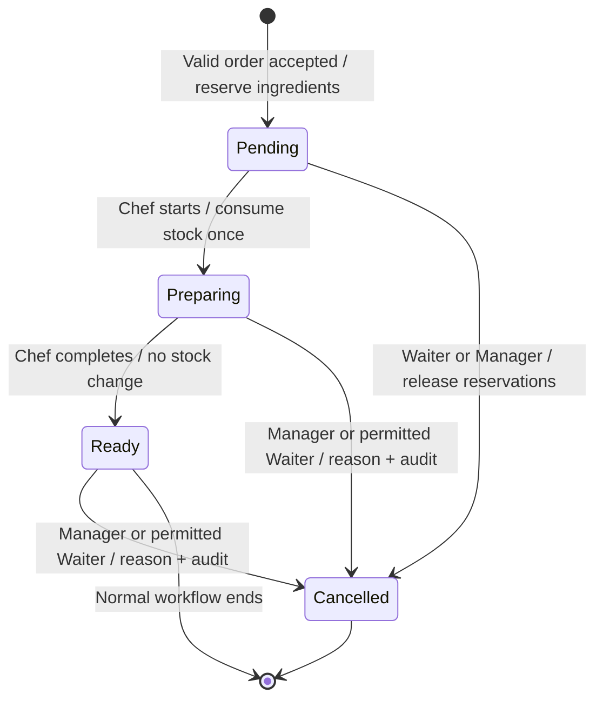

# PantryChef — Software Requirements Specification (SRS)

**Course:** BM 321 / SENG 321 — Software Engineering  
**Team:** Team 7  
**Sprint:** Sprint 2 — Requirements & Architecture  
**Document:** Detailed Software Requirements Specification  
**Deliverable:** `docs/srs.md`  
**Responsible:** Burcu Ücük — Product Owner and Requirements Engineer  
**Reviewer:** Ayşe Dural — Architecture / API  
**Related Issue:** [S2-01 — #44](https://github.com/seng321-7th-team/PantryChef/issues/44)  
**Version:** 0.1 — Review Draft  
**Date:** 17 November 2026  
**Status:** Draft — Pending Ayşe's review and team approval

---

## 1. Introduction

### 1.1 Purpose

This Software Requirements Specification defines the intended behavior, constraints, quality requirements, and verifiable acceptance conditions for the PantryChef MVP. It is a specification for design and testing, **not a claim of implemented or verified functionality**.

### 1.2 Product overview

PantryChef is a web-based restaurant order and ingredient-inventory coordination system. It supports order entry, a kitchen queue, recipe-based ingredient reservations, controlled stock consumption, inventory administration, and traceable cancellations. The system aims to prevent duplicate orders, over-reservation, and inconsistent stock changes.

### 1.3 Reference baseline

- `docs/project-proposal.md` — project objectives and scope.
- `docs/system-vision.md` — actors, boundary, order lifecycle, and business rules.
- `docs/product-backlog.md` — Epics and user stories US-01 through US-14 (and deferred stories).
- `docs/non-functional-requirements.md` — FR-01 through FR-14 and NFR-01 through NFR-15.
- `api/openapi.yaml` — Sprint 1 API draft; endpoint details are subject to review.
- `docs/sprint2-task-board.md` and `docs/sprint2-raci.md` — Sprint 2 ownership and review workflow.

If these artifacts conflict, the discrepancy must be recorded and resolved with the relevant owners; this document does not silently override an approved baseline.

### 1.4 Terminology

| Term | Meaning |
|---|---|
| MVP | Minimum Viable Product: agreed first-release scope |
| SRS | Software Requirements Specification |
| Physical / `onHand` | Recorded quantity physically held in inventory |
| Reserved | Quantity allocated to accepted orders awaiting preparation |
| Available | Physical minus Reserved |
| Atomic transaction | An operation that commits all related changes or none |
| Idempotency | Replaying the same logical request does not duplicate effects |
| Audit record | Traceable actor, timestamp, operation, and relevant context |
| FR / NFR / US | Functional Requirement / Non-Functional Requirement / User Story |

## 2. Overall Description

### 2.1 Users and access boundaries

| Primary actor | Authorized responsibilities |
|---|---|
| Waiter | Create orders, view their status, cancel Pending orders; late cancellation only with explicitly granted additional permission |
| Chef / Kitchen Staff | View Pending orders, start preparation, mark orders Ready |
| Restaurant Manager | Manage ingredient and recipe data, adjust stock, monitor low-stock alerts, review history, perform authorized cancellations |

A specially authorized Waiter is **not** a fourth primary actor. Customers and suppliers are external stakeholders and are not authenticated MVP actors. The system must enforce permissions server-side, not merely by hiding UI controls.

### 2.2 MVP included functionality

- Authenticated role-based operations for restaurant staff.
- Ingredient and versioned recipe management.
- Physical, Reserved, and Available stock visibility and authorized stock adjustments.
- Waiter order creation, stock validation, and all-or-nothing reservation.
- Kitchen queue and Pending → Preparing → Ready status updates.
- Exactly-once stock consumption at preparation start.
- Controlled Pending and exceptional late cancellations, with audit history.
- Low-stock monitoring and basic order/inventory history.

### 2.3 Exclusions

Customer self-ordering, payments and billing, table reservations, delivery/courier tracking, a `Delivered` state, third-party delivery integrations, supplier API integration, automated purchasing, goods receipt processing, advanced analytics, advanced accounting and financial modules, multi-branch management, hardware stock sensing, and automatic restoration of physically consumed ingredients after late cancellation are outside this MVP.

### 2.4 Assumptions and constraints

- Restaurant staff use the web application and enter correct ingredient quantities, units, and recipes.
- Staff physically handle food and verify real-world inventory; the application maintains digital records only.
- The OpenAPI file is a **draft contract**, not evidence of implemented endpoints.
- Exact infrastructure, deployment, browser-test versions, and performance-test environment require team agreement.
- Purchase-order and supplier workflows remain deferred unless the team explicitly approves a scope change.

## 3. System Behaviour and Business Logic

### 3.1 Order lifecycle

`Ready` ends the normal workflow but allows the documented exceptional cancellation. `Cancelled` is terminal. Unsupported transitions must be rejected without stock changes.

### 3.2 Inventory invariants

`Available Stock = Physical Stock - Reserved Stock`

- On accepted Pending creation, Reserved increases; Physical stays unchanged.
- On Pending → Preparing, Physical decreases by the order's reserved amount and the matching reservation is consumed/released **in one atomic operation**. Available does not decrease a second time.
- On Preparing → Ready, inventory does not change.
- On Pending → Cancelled, the order's active reservations are released once; Physical remains unchanged.
- On Preparing/Ready → Cancelled, consumed stock is not automatically returned; an authorized reason and audit record are mandatory.
- No valid concurrent operation may over-reserve inventory or create negative Available stock.
- A failed operation must leave neither a partial order nor partial stock changes.

### 3.3 Recipe versions and duplicate requests

Each accepted order retains the recipe version and ingredient quantities used for its reservation; subsequent recipe edits must not retroactively change that order. The OpenAPI draft requires `Idempotency-Key` for `POST /orders`, with the same key and request body returning the original result. Status changes must also protect against duplicate physical consumption. The exact error behavior for key reuse with a different body must follow the reviewed API contract.

## 4. Detailed Functional and Quality Requirements

The following requirement identifiers and definitions are preserved from the Sprint 2 functional/non-functional requirements deliverable so that cross-document traceability remains stable. The proposed numeric NFR targets remain **pending technical and QA agreement**.

### 4.1 Functional Requirements

Functional requirements describe the operations that the system must perform.

#### 4.1.1 Access Control

**FR-01 — Role-Based Authorization**

The system shall recognize the Waiter, Chef/Kitchen Staff, and Restaurant Manager roles and enforce permissions for protected operations.

**Acceptance Criteria:**
- Authorized users can perform operations permitted for their roles.
- Unauthorized operations are rejected without modifying application data.
- Exceptional cancellation permissions are explicitly checked.

**Related Story:** US-01

#### 4.1.2 Ingredient and Recipe Management

**FR-02 — Ingredient Management**

The system shall allow authorized Restaurant Managers to create, view, update, and deactivate ingredient records.

Each ingredient shall have a name, measurement unit, and low-stock threshold. Upon creation, its physical stock shall be initialized to zero. Initial stock shall be recorded through a separate authorized inventory adjustment.

**Related Story:** US-02

**FR-03 — Available Inventory**

The system shall maintain or reliably derive physical, reserved, and available ingredient quantities.

`Available Stock = Physical Stock - Reserved Stock`

Available stock shall not become negative through valid order operations.

**Related Story:** US-03

**FR-04 — Inventory Adjustments**

The system shall allow authorized managers to adjust physical inventory with a recorded reason, actor, and timestamp.

Adjustments that would reduce physical stock below reserved stock shall be rejected.

**Related Story:** US-04

**FR-05 — Recipe Management**

The system shall allow authorized managers to maintain recipes containing ingredient references and positive quantities per portion.

Existing orders shall preserve their original ingredient requirements after recipe changes.

**Related Story:** US-05

#### 4.1.3 Order Creation and Reservation

**FR-06 — Order Creation**

The system shall allow only authorized Waiters to create orders containing valid menu items and positive portion quantities. Restaurant Managers and Chefs/Kitchen Staff shall not be permitted to create orders.

Successfully created orders shall receive unique identifiers and enter the `Pending` state.

**Related Story:** US-06

**FR-07 — Atomic Ingredient Reservation**

The system shall calculate all required ingredient quantities and verify availability before accepting an order.

If all ingredients are sufficient, the system shall reserve the complete required quantities atomically.

If any ingredient is insufficient, the system shall reject the entire operation without creating an order or partial reservation.

Physical stock shall remain unchanged during reservation.

Concurrent requests shall not over-reserve available inventory, and repeated logical submissions shall not create duplicate orders or reservations.

**Related Story:** US-07

#### 4.1.4 Kitchen Operations

**FR-08 — Kitchen Order Visibility**

The system shall allow authorized kitchen staff to view incoming `Pending` orders, including order identifiers, menu items, quantities, and statuses.

Cancelled orders shall not appear as active preparation tasks.

**Related Story:** US-08

**FR-09 — Preparation and Stock Consumption**

The system shall allow authorized Chefs to change an order from `Pending` to `Preparing`.

During this transition, the system shall atomically transition the order's active ingredient reservations to `CONSUMED`, decrease the corresponding reserved quantities, and deduct the corresponding physical stock exactly once.

Repeated requests shall not cause duplicate deductions.

**Related Story:** US-09

**FR-10 — Order Completion**

The system shall allow authorized kitchen staff to change an order from `Preparing` to `Ready`.

This transition shall not change physical or reserved inventory quantities.

**Related Story:** US-10

#### 4.1.5 Cancellation and Auditability

**FR-11 — Pending Order Cancellation**

The system shall allow a Waiter or Restaurant Manager to cancel a `Pending` order.

Cancellation shall release its ingredient reservations atomically without changing physical stock.

Repeated cancellation requests shall not release the same reservation more than once.

**Related Story:** US-11

**FR-12 — Exceptional Cancellation**

The system shall allow a Restaurant Manager or specifically authorized Waiter to cancel an order in `Preparing` or `Ready`.

The operation shall require a cancellation reason and record the responsible user, timestamp, previous state, and order identifier.

Previously consumed physical stock shall not be automatically restored.

**Related Story:** US-12

**FR-13 — Operation History**

The system shall maintain traceable records of significant order transitions, reservations, stock consumption, cancellations, and inventory adjustments.

Authorized managers shall be able to review these records.

**Related Story:** US-13

#### 4.1.6 Low-Stock Monitoring

**FR-14 — Low-Stock Alerts**

The system shall identify an ingredient as low-stock when:

`Available Stock <= Low-Stock Threshold`

Alerts shall reflect relevant reservations, consumption, cancellations, and inventory adjustments.

Authorized Restaurant Managers shall be able to view current low-stock items.

The MVP shall not automatically create purchase orders.

**Related Story:** US-14

### 4.2 Non-Functional Requirements

Non-functional requirements describe quality attributes and constraints.

The measurable targets below are **proposed Sprint 2 acceptance targets**, not verified implementation results or previously approved performance commitments. They require review by the technical lead and QA engineer.

#### 4.2.1 Performance

**NFR-01 — Response Time**

Under a proposed test workload of 20 concurrent users, 95% of ordinary order-list and inventory-read requests should complete within 2 seconds in the agreed test environment.

**Verification:** Automated API response-time testing.

**NFR-02 — Transaction Performance**

Under the same proposed workload, 95% of valid order creation and reservation transactions should complete within 3 seconds.

**Verification:** Integration and performance testing.

#### 4.2.2 Reliability and Data Integrity

**NFR-03 — Atomic Transactions**

Order creation, ingredient reservation, preparation-related stock consumption, and cancellation-related reservation release shall use all-or-nothing transaction behavior.

**Verification:** Transaction rollback and failure-injection tests.

**NFR-04 — Inventory Consistency**

Valid system operations shall preserve the relationship between physical, reserved, and available stock.

No successful operation shall cause negative available inventory.

**Verification:** Inventory invariant and concurrent-request tests.

**NFR-05 — Duplicate Operation Protection**

Repeated logical order submissions, preparation requests, and cancellation requests shall not produce duplicate inventory effects.

**Verification:** Idempotency and repeated-request tests.

#### 4.2.3 Security

**NFR-06 — Authorization Enforcement**

Protected operations shall enforce role-based permissions on the server side.

Unauthorized requests shall not change protected application data.

**Verification:** Positive and negative authorization tests.

**NFR-07 — Input Validation**

The system shall validate required fields, ingredient quantities, order quantities, identifiers, and cancellation reasons before processing protected operations.

Invalid input shall be rejected without unintended data changes.

**Verification:** Input validation and negative test cases.

**NFR-08 — Sensitive Operation Traceability**

Significant inventory adjustments and exceptional cancellations shall be associated with the responsible user and timestamp.

Audit records shall not be modifiable through ordinary unauthorized application operations.

**Verification:** Audit-record inspection and access-control tests.

#### 4.2.4 Usability

**NFR-09 — Clear Operational Feedback**

The user interface shall display understandable feedback for successful operations, invalid inputs, insufficient inventory, unauthorized actions, and invalid state transitions.

**Verification:** Scenario-based UI acceptance testing.

**NFR-10 — Role-Appropriate Interface**

The interface shall present the relevant operational functions for each supported role and clearly distinguish order status and inventory quantities.

**Verification:** Role-based interface review and usability testing.

#### 4.2.5 Maintainability and Compatibility

**NFR-11 — Modular Design**

The system should separate order management, inventory management, recipe management, authorization, and audit responsibilities into maintainable components.

**Verification:** Architecture and code review.

**NFR-12 — API Contract Consistency**

Implemented API operations shall remain consistent with the reviewed OpenAPI contract and approved business rules.

Changes affecting the API contract shall be documented and reviewed.

**Verification:** API contract review and integration tests.

**NFR-13 — Web Application Compatibility**

The system should support current stable versions of Chrome and Firefox in the agreed test environment.

**Verification:** Cross-browser functional testing.

#### 4.2.6 Testability and Recovery

**NFR-14 — Automated Verification**

Critical business rules shall be covered by automated tests, particularly atomic reservation, concurrent requests, preparation consumption, cancellation, and authorization.

**Verification:** Test execution and CI reports.

**NFR-15 — Failure Recovery**

A failed inventory-related transaction shall not leave partially committed order states or inventory quantities.

**Verification:** Simulated transaction failure and rollback tests.

## 5. External Interfaces and API Alignment

### 5.1 User interfaces

The Waiter interface should support order entry, current order status, and permitted cancellation. The kitchen interface should show the Pending queue and allowed preparation transitions. The Manager interface should expose ingredient/recipe maintenance, physical/reserved/available quantities, low-stock information, adjustments, and authorized audit/history views. Figma screen design and flow details are separate Sprint 2 deliverables and require a UI-to-requirement review.

### 5.2 API operations in the current draft

| Capability | OpenAPI draft operation | Linked requirement |
|---|---|---|
| Authentication/profile | `POST /auth/login`, `GET /auth/me` | FR-01 |
| Staff management | `/users`, `/users/{userId}` | FR-01 |
| Ingredient management | `/ingredients`, `/ingredients/{ingredientId}` | FR-02 |
| Stock availability and adjustment | `GET /inventory`, `/inventory/adjustments`, `/ingredients/{ingredientId}/stock` | FR-03, FR-04 |
| Recipes and versions | `/recipes`, `/recipes/{menuItemId}/versions`, `/recipes/{menuItemId}` | FR-05 |
| Menu catalogue | `/menu-items`, `/menu-items/{menuItemId}` | FR-05, FR-06 |
| Order creation and listing | `/orders`, `/orders/{orderId}` | FR-06, FR-08 |
| Status and cancellation | `PATCH /orders/{orderId}/status` | FR-09 through FR-12 |
| Reservation inspection | `/reservations`, `/reservations/{reservationId}` | FR-07, FR-09, FR-11 |
| Stock alerts | `/inventory/low-stock-alerts` | FR-14 |
| Audit and movements | `/audit-logs`, `/inventory/movements` | FR-13 |

The API draft uses uppercase enum values `PENDING`, `PREPARING`, `READY`, `CANCELLED`, while this SRS uses title case for human-readable state names. These refer to the same states; integrations must use the contract's exact enum spelling. The API server prefix is `/v1`. Authentication uses bearer tokens in the draft; actual implementation and security review remain separate.

### 5.3 Error and permission expectations

- Insufficient stock: reject atomically (draft API uses HTTP `409` and `INSUFFICIENT_STOCK`).
- Invalid state transition: reject without side effects (draft API uses HTTP `409` and `INVALID_STATUS_TRANSITION`).
- Unauthorized operations: no protected data change; distinguish unauthenticated and forbidden actions according to the reviewed API contract.
- Validation errors: provide understandable feedback without modifying inventory.
- Draft API errors follow RFC 9457 Problem Details with an additional `code` field.

## 6. Acceptance and Verification

The scenarios and traceability below are taken from the Sprint 2 requirements baseline and are intended for test design, not claims of passing tests.

### 6.1 Business Rules and Invariants

The following rules are mandatory for MVP consistency:

| ID | Business Rule |
|---|---|
| BR-01 | Supported states are Pending, Preparing, Ready, and Cancelled. |
| BR-02 | Ingredient reservation is atomic. |
| BR-03 | Available Stock = Physical Stock - Reserved Stock. |
| BR-04 | Pending reserves ingredients without reducing physical stock. |
| BR-05 | Preparing consumes reservations and deducts physical stock exactly once. |
| BR-06 | Ready causes no additional stock deduction. |
| BR-07 | Pending cancellation releases reservations without changing physical stock. |
| BR-08 | Preparing/Ready cancellation requires elevated authorization and a recorded reason. |
| BR-09 | Late cancellation does not automatically restore consumed stock. |
| BR-10 | Unauthorized operations and invalid transitions are rejected. |
| BR-11 | Duplicate requests must not create duplicate inventory effects. |
| BR-12 | Significant order and inventory operations must be traceable. |

### 6.2 Requirements Traceability Matrix

| Functional Requirement | Backlog Story | Related Quality Requirements |
|---|---|---|
| FR-01 | US-01 | NFR-06, NFR-07 |
| FR-02 | US-02 | NFR-07, NFR-08 |
| FR-03 | US-03 | NFR-04 |
| FR-04 | US-04 | NFR-03, NFR-08 |
| FR-05 | US-05 | NFR-07, NFR-11 |
| FR-06 | US-06 | NFR-01, NFR-07 |
| FR-07 | US-07 | NFR-02, NFR-03, NFR-04, NFR-05 |
| FR-08 | US-08 | NFR-01, NFR-10 |
| FR-09 | US-09 | NFR-03, NFR-04, NFR-05 |
| FR-10 | US-10 | NFR-04, NFR-09 |
| FR-11 | US-11 | NFR-03, NFR-05 |
| FR-12 | US-12 | NFR-06, NFR-08 |
| FR-13 | US-13 | NFR-08 |
| FR-14 | US-14 | NFR-04, NFR-09 |

### 6.3 Acceptance and Verification Scenarios

The following scenarios shall guide requirements validation:

1. **Successful order:** A valid order creates a Pending record and reserves all required ingredients.
2. **Insufficient stock:** An order requiring an unavailable ingredient is rejected without partial changes.
3. **Concurrent orders:** Competing orders cannot reserve more stock than is available.
4. **Preparation:** Starting preparation deducts physical stock exactly once and releases the reservation.
5. **Repeated preparation:** Repeating a preparation request causes no additional stock deduction.
6. **Ready transition:** Marking an order Ready does not change inventory quantities.
7. **Pending cancellation:** Cancelling a Pending order releases reservations and preserves physical stock.
8. **Late cancellation:** Authorized cancellation records the reason without automatically restoring consumed ingredients.
9. **Unauthorized action:** A user without permission cannot modify protected data.
10. **Low-stock threshold:** An ingredient is flagged when available stock reaches or falls below its threshold.
11. **Invalid transition:** An unsupported order state transition is rejected.
12. **Transaction failure:** A failed operation leaves no partial inventory or order updates.

### 6.4 Additional acceptance examples

| Scenario | Preconditions | Expected result |
|---|---|---|
| Insufficient ingredient | Order needs 6 units; Available = 5 | Order rejected; no order/reservation/stock mutation |
| Normal preparation | Physical = 20, Reserved = 5 for one Pending order | After Preparing: Physical = 15, Reserved = 0, Available = 15; replay causes no second deduction |
| Pending cancellation | Physical = 20, Reserved = 5 | After Cancelled: Physical = 20, Reserved = 0, Available = 20 |
| Late cancellation without permission | Preparing order, ordinary Waiter | Rejected; no inventory or order change |
| Late cancellation with permission | Preparing/Ready order, authorized actor and reason | Cancelled; audit includes actor, reason, previous state, timestamp; consumed stock unchanged |
| Recipe update | Existing Pending order references version 2 | New recipe version does not change the accepted order's reserved quantities |

## 7. Cross-Document Traceability and Review

- **FR ↔ US:** FR-01–FR-14 map to US-01–US-14 in the Sprint 2 requirements baseline.
- **FR ↔ NFR:** The requirements traceability matrix in Section 6.2 identifies associated quality constraints.
- **FR ↔ API:** Section 5.2 maps major capabilities to current draft API paths; Ayşe must verify operation-level details.
- **FR ↔ tests:** Beyzanur should link test-case IDs when `docs/testing/test-cases.md` is available. No test IDs or test passes are invented here.
- **FR ↔ Figma:** Tuğçe and Burcu should review the Waiter/Chef/Manager screens and document mismatches when the Figma deliverable is available.

## 8. Open Questions and Approval Gates

1. **Performance targets:** Confirm the proposed 20-user workload and 2-second/3-second p95 targets with Ayşe, Emre, and Beyzanur.
2. **Authentication and staff management:** Confirm whether all `/users` operations are needed for the agreed MVP UI and implementation phase.
3. **Recipe versioning:** Confirm API response details and persisted order-item recipe-version behavior with Ayşe.
4. **Idempotency:** Confirm replay and mismatched-body behavior across order creation and status transitions.
5. **UI validation:** Review Figma screens and role-specific actions with Tuğçe.
6. **Testing:** Add real test-case IDs and verification evidence when Beyzanur's test artifacts are ready.
7. **Document status:** Update the SRS status only after Ayşe's PR review and merge into `develop`.

## 9. Dependencies and Assumptions

- The system initially supports one restaurant.
- Ingredient quantities and recipes are maintained by authorized staff.
- Restaurant employees are responsible for physical inventory verification.
- Reservations are logical allocations rather than separate physical storage.
- Detailed API paths and schemas are maintained in `api/openapi.yaml`.
- The SRS document and architecture artifacts must follow the same approved business rules.
- Proposed quantitative quality targets require technical and QA approval before being treated as baselines.
- Procurement and goods-receipt stories US-15 and US-16 are P1 post-MVP features and are excluded from these MVP requirements.

## 10. Review and Completion Checklist

- [ ] Functional requirements reviewed against the Project Proposal.
- [ ] Requirements verified against the System Vision.
- [ ] Backlog story references reviewed.
- [ ] Functional requirements checked against the SRS.
- [ ] API-related requirements reviewed against the OpenAPI draft.
- [ ] Proposed performance targets reviewed by the technical lead.
- [ ] Testability and verification scenarios reviewed by Beyzanur.
- [ ] MVP scope and business rules confirmed.
- [ ] Pull request linked to Issue #44 (S2-01).
- [ ] Changes reviewed and merged into `develop`.

## 11. Related Documents

- `docs/project-proposal.md`
- `docs/system-vision.md`
- `docs/product-backlog.md`
- `api/openapi.yaml`
- `docs/sprint2-task-board.md`
- `docs/sprint2-raci.md`

## 12. Conclusion

This document establishes a structured and testable requirements baseline for the PantryChef MVP.

It preserves the approved order lifecycle, atomic ingredient reservation, exactly-once physical stock consumption, controlled cancellation, role-based authorization, and low-stock monitoring rules.

The requirements will support Sprint 2 SRS refinement, architecture design, API consistency review, and future implementation and testing.

**Document Owner:** Burcu Ücük  
**Review Status:** Pending Technical and QA Review  
**Related Issue:** #44 — S2-01

## 13. Definition of Done for S2-01 / Issue #44

- [x] System purpose, boundaries, stakeholders, and primary roles documented.
- [x] Functional requirements use stable identifiers and acceptance criteria.
- [x] Inventory lifecycle, atomic reservation, exactly-once consumption, and cancellation rules documented.
- [x] Authentication/authorization, recipe versions, low-stock alerts, and audit requirements included.
- [x] NFRs referenced with proposed verification measures.
- [x] Backlog-to-SRS and API-to-SRS traceability established at requirement/capability level.
- [x] Assumptions, exclusions, and unresolved review decisions identified.
- [ ] Ayşe completes GitHub PR review and requests/approves corrections.
- [ ] Approved SRS merged into `develop`; Issue #44 closes through linked PR.

---

**Change control:** Updates to this SRS that alter the approved scope, permissions, inventory effects, or API contract require cross-document review and traceable GitHub changes.
