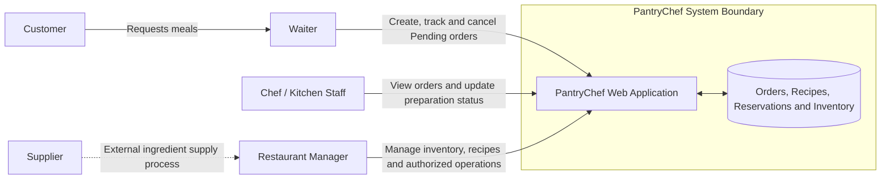
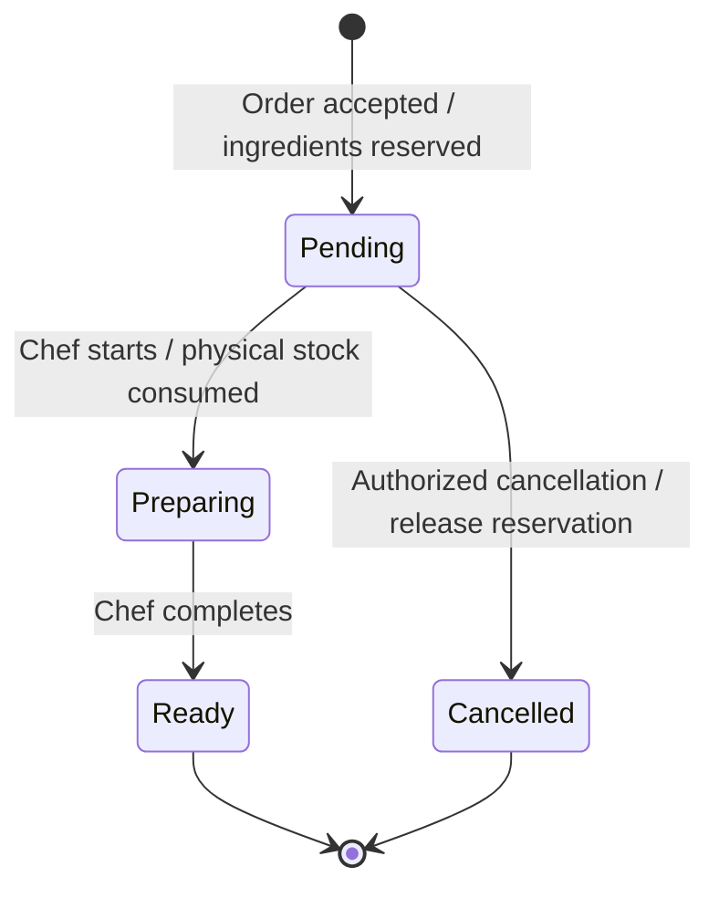

# PantryChef — System Vision and System Boundary Specification

**Course:** BM 321 — Software Engineering  
**Team:** Team 7  
**Project:** PantryChef  
**Sprint:** Sprint 1 — Project Foundation  
**Responsible:** Burcu Ücük  
**Role:** Product Owner and Requirements Engineer  
**RACI:** Responsible (R) and Accountable (A)  
**Consulted:** Ayşe Dural, Tuğçe Çevik, Beyzanur Alpay  
**Deliverable:** `docs/system-vision.md`  
**Status:** Draft — Pending Team Review

---

## 1. Purpose

This document defines the system vision, operational context, system boundaries, stakeholders, high-level capabilities, and business rules of PantryChef.

It establishes a shared understanding of what the proposed system will do, what lies outside its responsibility, and how restaurant orders interact with ingredient reservations and physical inventory.

This document is aligned with the PantryChef Project Proposal and the team's approved order workflow. It provides a foundation for the Initial Product Backlog, OpenAPI draft, and later software requirements.

## 2. System Vision

PantryChef is a web-based restaurant order management and ingredient inventory tracking system that coordinates waiters, chefs, and restaurant managers.

Its vision is to reduce duplicate order entry, improve visibility of ingredient availability, and ensure that order processing and inventory changes follow consistent and traceable rules.

The system separates ingredient reservations from physical inventory consumption. Ingredients are reserved when an order is accepted into the Pending state, while physical stock is consumed only when the chef starts preparation.

PantryChef aims to provide a practical, understandable, and maintainable solution suitable for a restaurant environment and the educational scope of BM 321.

## 3. Problem and Motivation

Restaurants may experience operational problems when order records, kitchen activities, and ingredient inventory are managed separately.

These problems include:

- Duplicate or inconsistent order entry.
- Limited visibility of incoming kitchen orders.
- Inaccurate information about ingredients available for new orders.
- Confusion between ingredients reserved for orders and ingredients physically consumed.
- Incorrect stock changes when orders are cancelled.
- Delayed identification of low-stock ingredients.
- Insufficient traceability of important inventory and order operations.

PantryChef addresses these problems through centralized order tracking, recipe-based ingredient requirements, atomic reservations, controlled stock consumption, and explicit order state transitions.

## 4. System Objectives

The main objectives are:

1. Provide one consistent record for each restaurant order.
2. Allow authorized waiters to create and track orders.
3. Allow chefs to view incoming orders and update preparation status.
4. Allow restaurant managers to maintain ingredient inventory and recipe information.
5. Reserve required ingredients without immediately reducing physical stock.
6. Prevent orders from reserving ingredients that are unavailable.
7. Consume reserved ingredients exactly once when preparation begins.
8. Support controlled cancellation according to the current order state.
9. Provide low-stock visibility to restaurant managers.
10. Maintain traceable order and inventory operations.

## 5. Stakeholders and Actors

### 5.1 Primary Actors

| Actor | Responsibilities |
|---|---|
| Waiter | Create customer orders, view order statuses, and cancel Pending orders according to authorization rules. |
| Chef / Kitchen Staff | View Pending orders, start preparation, and mark prepared orders as Ready. |
| Restaurant Manager | Manage ingredients, recipes, stock quantities, inventory adjustments, and low-stock monitoring; perform authorized cancellations. |

### 5.2 External Stakeholders

| Stakeholder | Relationship |
|---|---|
| Customer | Requests meals through restaurant staff and receives prepared orders; does not directly interact with the MVP. |
| Supplier | Provides ingredients to the restaurant; direct supplier-system integration is outside the MVP. |
| Project Team | Designs, implements, tests, and maintains the software. |
| Course Instructor | Evaluates project deliverables and engineering practices. |

Customers and suppliers are stakeholders, not authenticated primary system actors in the initial MVP.

## 6. System Context

PantryChef operates within a restaurant and provides a centralized interface for staff.

The Waiter submits and tracks orders.

The Chef receives Pending orders and performs preparation-state transitions.

The Restaurant Manager maintains recipes and ingredient inventory, reviews stock information, and handles authorized management operations.

Customers communicate their requests to the restaurant staff. Suppliers provide ingredients through external business processes.

### 6.1 System Context Diagram



The supplier relationship is external to the software boundary and does not represent an automated integration.

## 7. System Boundary Specification

### 7.1 Inside the System Boundary

The proposed MVP includes:

- Role-based access for restaurant staff.
- Restaurant order creation and status tracking.
- Recipe definitions and ingredient requirements.
- Ingredient inventory records.
- Available-stock calculations.
- Atomic ingredient reservation.
- Physical stock consumption when preparation begins.
- Order cancellation according to defined permissions and states.
- Low-stock monitoring and alerts.
- Basic order and inventory operation records.

### 7.2 Outside the MVP Boundary

The following capabilities are excluded from the initial MVP:

- Customer-facing online ordering.
- Online payments and billing.
- Table reservations.
- Delivery and courier tracking.
- Automated supplier ordering and supplier API integration.
- Advanced sales forecasting and analytics.
- Multi-restaurant or multi-branch administration.
- Hardware-based inventory sensing.
- Automatic restoration of physically consumed stock after late cancellation.

Purchase-order and goods-receipt workflows may be considered future enhancements, subject to backlog prioritization and team approval. They are not required for the core order-reservation workflow described here.

### 7.3 Boundary Responsibilities

PantryChef is responsible for maintaining consistent digital records and enforcing its defined business rules.

Restaurant employees remain responsible for actual food preparation, physical handling of ingredients, and verification of real-world inventory.

The system records authorized inventory adjustments but cannot independently verify physical ingredient quantities.

## 8. Inventory Model

PantryChef distinguishes three inventory concepts.

### 8.1 Physical Stock

Physical Stock represents the recorded quantity of an ingredient physically present in restaurant inventory.

### 8.2 Reserved Stock

Reserved Stock represents the quantity allocated to accepted Pending orders but not yet physically consumed.

Reserved quantities are logical allocations. They are not a separate physical warehouse or storage location.

### 8.3 Available Stock

Available Stock is calculated as:

```text
Available Stock = Physical Stock - Reserved Stock
```

An ingredient cannot be newly reserved if its available quantity is insufficient.

### 8.4 Example

Suppose a restaurant has 20 units of an ingredient.

A Pending order reserves 5 units.

- Physical Stock = 20
- Reserved Stock = 5
- Available Stock = 15

When the chef starts preparing this order:

- Physical Stock becomes 15.
- Reserved Stock becomes 0 for this order.
- Available Stock remains 15.

This prevents the same ingredient quantity from being deducted twice.

## 9. Order Lifecycle

The normal order lifecycle is:

```text
Order Created
     |
     v
Pending
     |
     | Chef starts preparation
     v
Preparing
     |
     | Chef completes preparation
     v
Ready
```

A Pending order may instead be cancelled by an authorized user.

### 9.1 Order State Diagram



Exceptional cancellation of a Preparing or Ready order is handled as a controlled management operation, with authorization, reason, and audit record. Such cancellation does not restore consumed inventory automatically.

### 9.2 State Definitions

| State | Meaning | Inventory Effect |
|---|---|---|
| Pending | Accepted order waiting for kitchen preparation | Ingredients reserved; physical stock unchanged |
| Preparing | Chef has started preparation | Reserved quantities released and physical stock deducted once |
| Ready | Preparation completed | No additional stock deduction |
| Cancelled | Order cancelled under applicable rules | Pending reservations released; previously consumed stock not automatically restored |

## 10. Reservation and Consumption Rules

### BR-01 — Recipe-Based Requirements

Ingredient requirements are calculated from the recipes and quantities associated with the order.

### BR-02 — Atomic Reservation

All required ingredients must be available before an order is accepted into Pending.

If any ingredient is insufficient, the entire reservation attempt is rejected.

No partial reservation or stock change is permitted.

### BR-03 — Pending Inventory Behavior

An accepted Pending order increases Reserved Stock for its required ingredients.

Physical Stock remains unchanged.

### BR-04 — Preparation Start

When the chef moves an order from Pending to Preparing, the system atomically:

1. Verifies that the order is eligible for the transition.
2. Reduces Physical Stock by the quantities reserved for the order.
3. Releases the corresponding Reserved Stock allocations.
4. Records the successful state transition and inventory operation.

The transition must not cause duplicate consumption.

### BR-05 — Ready State

When an order moves from Preparing to Ready, its preparation status changes without another physical inventory deduction.

### BR-06 — Inventory Consistency

Reservations, consumption, cancellation, and authorized adjustments must preserve inventory consistency and prevent invalid negative available quantities.

## 11. Cancellation Rules

### 11.1 Pending Cancellation

An authorized Waiter or Restaurant Manager may cancel an order in Pending.

The system:

1. Changes the order status to Cancelled.
2. Releases the order's ingredient reservations.
3. Leaves Physical Stock unchanged.
4. Records the cancellation.

### 11.2 Preparing or Ready Cancellation

Exceptional cancellation after preparation has started requires an authorized Restaurant Manager or specially authorized Waiter.

The operation must record the reason and the responsible user.

Ingredients already physically consumed are not automatically restored.

If a cancellation record is represented by the Cancelled status, the audit history must preserve the previous preparation state.

### 11.3 Cancellation Permissions

Ordinary Waiters may cancel Pending orders.

Exceptional cancellation of Preparing or Ready orders requires elevated authorization.

Chefs are not granted cancellation permission by default.

## 12. Main System Capabilities

### 12.1 Order Management

- Create orders with menu items and quantities.
- Validate recipe ingredient requirements.
- Reject orders with insufficient available stock.
- Track order status.
- Prevent duplicate state-transition processing.

### 12.2 Kitchen Operations

- Display incoming Pending orders.
- Start preparation.
- Complete preparation.
- Show current order status.

### 12.3 Inventory Management

- Maintain ingredient records.
- View Physical, Reserved, and Available Stock.
- Record authorized inventory adjustments.
- Identify low-stock conditions.

### 12.4 Recipe Management

- Define menu items and their required ingredients.
- Maintain recipe quantities.
- Use recipe requirements during order validation.

### 12.5 Traceability

- Record significant order state changes.
- Record reservation and consumption operations.
- Record authorized cancellations and their reasons.
- Associate sensitive operations with the responsible staff user.

## 13. High-Level Functional Requirements

| ID | Requirement |
|---|---|
| FR-01 | The system shall support authenticated restaurant staff roles. |
| FR-02 | The system shall allow authorized Waiters to create orders. |
| FR-03 | The system shall calculate ingredient requirements using recipes. |
| FR-04 | The system shall validate availability before accepting an order. |
| FR-05 | The system shall reserve all required ingredients atomically. |
| FR-06 | The system shall display Pending orders to kitchen staff. |
| FR-07 | The system shall consume reserved ingredients once when preparation begins. |
| FR-08 | The system shall allow kitchen staff to mark orders Ready. |
| FR-09 | The system shall release reservations when Pending orders are cancelled. |
| FR-10 | The system shall enforce elevated authorization for late cancellation. |
| FR-11 | The system shall not automatically restore consumed stock after late cancellation. |
| FR-12 | The system shall allow Managers to maintain ingredients and recipes. |
| FR-13 | The system shall provide low-stock visibility. |
| FR-14 | The system shall record significant order and inventory operations. |

These are high-level Sprint 1 requirements. Detailed SRS specifications and measurable non-functional requirements will be refined in later sprints.

## 14. Constraints and Assumptions

### Assumptions

- Restaurant staff use the system through a web interface.
- Menu recipes and ingredient quantities are maintained by authorized staff.
- Recorded physical stock is updated through authorized inventory operations.
- A customer order is entered by a Waiter.
- One restaurant is supported in the initial MVP.

### Constraints

- Development time is limited by the course sprint schedule.
- System scope must remain feasible for the project team.
- API definitions and backlog acceptance criteria must follow the same order and inventory rules.
- Inventory operations must avoid partial updates and duplicate consumption.
- Access permissions must reflect the defined restaurant roles.

## 15. Dependencies and Interfaces

PantryChef requires consistent interfaces between:

- Order management and recipe management.
- Order management and ingredient reservation.
- Kitchen status updates and physical inventory consumption.
- Cancellation operations and reservation records.
- Manager inventory functions and low-stock monitoring.

The Draft OpenAPI contract should represent these operations consistently.

Specific API paths, request schemas, and response codes are owned by the OpenAPI deliverable and should not be treated as finalized by this vision document.

## 16. Success Criteria

The proposed system should demonstrate that:

1. A valid order can be accepted and its ingredients reserved.
2. An order with insufficient ingredients is rejected without partial changes.
3. Pending reservations do not reduce Physical Stock.
4. Starting preparation consumes reserved ingredients exactly once.
5. Marking an order Ready does not consume ingredients again.
6. Cancelling a Pending order releases its reservations.
7. Late cancellation requires authorization and does not automatically restore consumed stock.
8. Managers can view ingredient quantities and low-stock information.
9. Relevant order and inventory operations are traceable.
10. The Project Proposal, System Vision, Initial Product Backlog, and OpenAPI draft describe consistent behavior.

## 17. Sprint 1 Collaboration and Deliverables

**Document Owner:** Burcu Ücük — Product Owner and Requirements Engineer.

**Consultation:**

- Ayşe Dural: Technical and API contract consistency.
- Tuğçe Çevik: Implementation and integration feasibility.
- Beyzanur Alpay: Testability of requirements and acceptance criteria.
- Bilgesu Nacak: Sprint tracking and responsibility coordination.
- Emre Boz: Repository workflow and documentation integration.

**Related Deliverables:**

- `docs/project-proposal.md`
- `docs/system-vision.md`
- `docs/product-backlog.md`
- Draft OpenAPI YAML
- Team Roles and RACI Matrix
- GitHub workflow documentation

## 18. Review Checklist

- [x] System vision and business objectives documented.
- [x] Primary actors and external stakeholders identified.
- [x] System boundary and exclusions defined.
- [x] System context diagram included.
- [x] Order lifecycle documented.
- [x] Physical, Reserved, and Available Stock distinguished.
- [x] Atomic reservation and consumption rules documented.
- [x] Pending and late cancellation rules documented.
- [x] High-level requirements and success criteria included.
- [ ] Technical review by Ayşe and Tuğçe.
- [ ] Acceptance-criteria review with Beyzanur.
- [ ] Final team approval.

---

**Document Status:** Draft — Pending Team Review

**End of System Vision and System Boundary Specification.**
