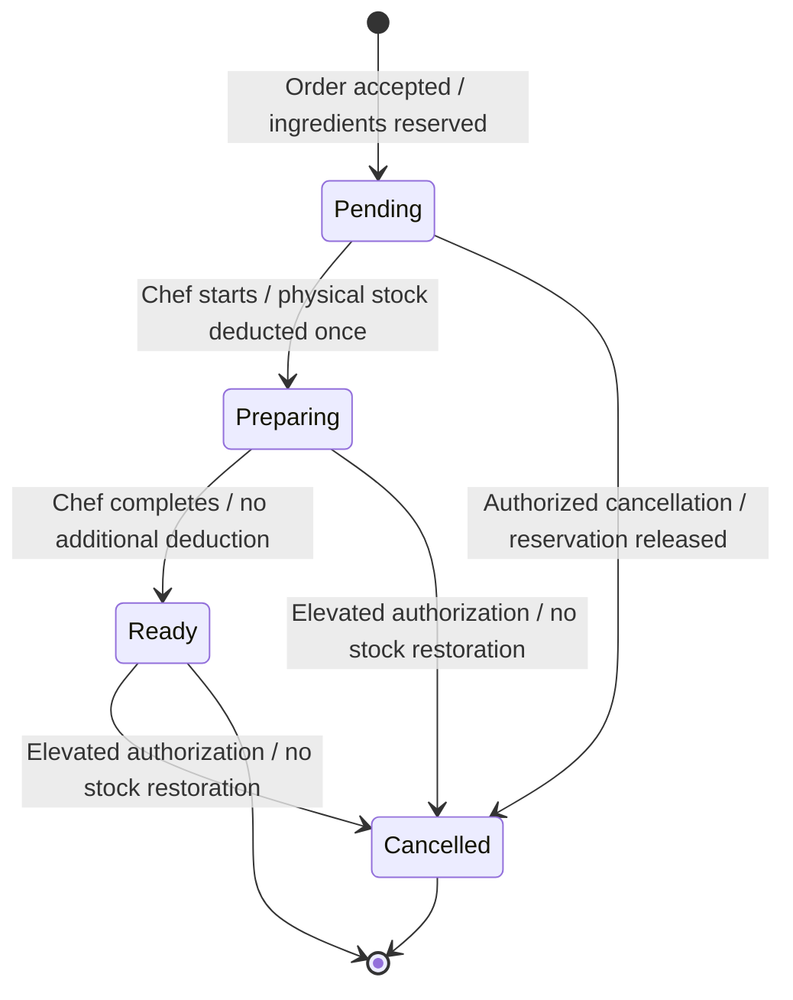

# PantryChef — System Vision and System Boundary Specification

**Course:** BM 321 — Software Engineering  
**Team:** Team 7  
**Project:** PantryChef  
**Sprint:** Sprint 1 — Project Foundation  
**Responsible:** Burcu Ücük  
**Role:** Product Owner and Requirements Engineer  
**RACI:** Responsible (R) and Accountable (A)  
**Consulted:** Ayşe Dural, Tuğçe Çevik, Beyzanur Alpay  
**Deliverable:** `docs/system-vision.md`  
**Status:** Revised — Pending Team Review

---

## 1. Purpose

This document defines the system vision, operational context, system boundaries, stakeholders, high-level capabilities, and business rules of PantryChef.

It establishes a shared understanding of what the proposed system will do, what lies outside its responsibility, and how restaurant orders interact with ingredient reservations and physical inventory.

This document is aligned with the updated PantryChef Project Proposal and the latest team order workflow diagram. It provides a foundation for the Initial Product Backlog, OpenAPI draft, and later software requirements.

## 2. System Vision

PantryChef is a web-based restaurant order management and ingredient inventory tracking system that coordinates waiters, chefs, and restaurant managers.

Its vision is to reduce duplicate order entry, improve visibility of ingredient availability, and ensure that order processing and inventory changes follow consistent and traceable rules.

The system separates ingredient reservations from physical inventory consumption. Ingredients are reserved when an order is accepted into the Pending state, while physical stock is consumed only when the chef starts preparation.

PantryChef aims to provide a practical, understandable, and maintainable solution suitable for a restaurant environment and the educational scope of BM 321.

## 3. Problem and Motivation

Restaurants may experience operational problems when order records, kitchen activities, and ingredient inventory are managed separately.

These problems include:

- Duplicate or inconsistent order entry.
- Limited visibility of incoming kitchen orders.
- Inaccurate information about ingredients available for new orders.
- Confusion between ingredients reserved for orders and ingredients physically consumed.
- Incorrect stock changes when orders are cancelled.
- Delayed identification of low-stock ingredients.
- Insufficient traceability of important inventory and order operations.

PantryChef addresses these problems through centralized order tracking, recipe-based ingredient requirements, atomic reservations, controlled stock consumption, and explicit order state transitions.

## 4. System Objectives

The main objectives are:

1. Provide one consistent record for each restaurant order.
2. Allow authorized waiters to create and track orders.
3. Allow chefs to view incoming orders and update preparation status.
4. Allow restaurant managers to maintain ingredient inventory and recipe information.
5. Reserve required ingredients without immediately reducing physical stock.
6. Prevent orders from reserving ingredients that are unavailable.
7. Consume reserved ingredients exactly once when preparation begins.
8. Support controlled cancellation according to the current order state.
9. Provide low-stock visibility to restaurant managers.
10. Maintain traceable order and inventory operations.
11. Prevent duplicate order submissions and repeated inventory deductions.
12. Maintain consistency between order states and inventory records.

## 5. Stakeholders and Actors

### 5.1 Primary Actors

| Actor | Responsibilities |
|---|---|
| Waiter | Create customer orders, view order statuses, cancel Pending orders, and perform exceptional cancellation only with additional authorization. |
| Chef / Kitchen Staff | View Pending orders, start preparation, update orders to Preparing, and mark completed orders as Ready. |
| Restaurant Manager | Manage ingredients, recipes, stock quantities, inventory adjustments, low-stock monitoring, and authorized cancellations. |

The system has three primary actors: Waiter, Chef / Kitchen Staff, and Restaurant Manager.

Additional cancellation permissions do not introduce a fourth primary actor.

### 5.2 External Stakeholders

| Stakeholder | Relationship |
|---|---|
| Customer | Requests meals through restaurant staff and receives prepared orders; does not directly interact with the MVP. |
| Supplier | Provides ingredients to the restaurant; direct supplier-system integration is outside the MVP. |
| Project Team | Designs, implements, tests, and maintains the software. |
| Course Instructor | Evaluates project deliverables and engineering practices. |

Customers and suppliers are stakeholders, not authenticated primary system actors in the initial MVP.

## 6. System Context

PantryChef operates within a restaurant and provides a centralized web interface for authorized staff.

The Waiter submits customer orders, monitors their progress, and performs permitted cancellations.

The Chef receives Pending orders, confirms preparation start, and updates order preparation statuses.

The Restaurant Manager maintains recipes and ingredient inventory, reviews stock information, configures low-stock thresholds, and performs authorized management operations.

Customers communicate their requests to restaurant staff. Suppliers provide ingredients through external business processes.

### 6.1 System Context Diagram


The supplier relationship is external to the software boundary and does not represent automated supplier integration.

Physical food preparation and ingredient handling are performed by restaurant employees, not by the software.

## 7. System Boundary Specification

### 7.1 Inside the System Boundary

The proposed MVP includes:

- Role-based access for restaurant staff.
- Restaurant order creation and status tracking.
- Duplicate order submission protection.
- Recipe definitions and ingredient requirements.
- Ingredient inventory records.
- Physical, Reserved, and Available Stock tracking.
- Available-stock calculations.
- Atomic ingredient reservation.
- Physical stock consumption when preparation begins.
- Prevention of duplicate inventory deductions.
- Order cancellation according to defined permissions and states.
- Cancellation reasons and traceable records.
- Low-stock monitoring and alerts.
- Authorized inventory adjustments.
- Basic order and inventory operation records.

### 7.2 Outside the MVP Boundary

The following capabilities are excluded from the initial MVP:

- Customer-facing online ordering.
- Online payments and billing.
- Table reservations.
- Delivery and courier tracking.
- Third-party delivery platform integration.
- Automated supplier ordering and supplier API integration.
- Advanced sales forecasting and analytics.
- Multi-restaurant or multi-branch administration.
- Hardware-based inventory sensing.
- Advanced accounting and financial modules.
- A separate Delivered order state.

Automatic restoration of physically consumed ingredients after late cancellation is not supported.

Purchase-order and goods-receipt workflows may be considered future enhancements, subject to backlog prioritization and team approval. They are not required for the core MVP order-reservation workflow.

### 7.3 Boundary Responsibilities

PantryChef is responsible for maintaining consistent digital records and enforcing its defined business rules.

Restaurant employees remain responsible for actual food preparation, physical handling of ingredients, and verification of real-world inventory.

The system records authorized inventory adjustments but cannot independently verify physical ingredient quantities.

## 8. Inventory Model

PantryChef distinguishes three inventory concepts.

### 8.1 Physical Stock

Physical Stock represents the recorded quantity of an ingredient physically present in restaurant inventory.

### 8.2 Reserved Stock

Reserved Stock represents the quantity allocated to accepted Pending orders but not yet physically consumed.

Reserved quantities are logical allocations. They are not a separate physical warehouse or storage location.

### 8.3 Available Stock

Available Stock is calculated as:

```text
Available Stock = Physical Stock - Reserved Stock
```

An ingredient cannot be newly reserved if its available quantity is insufficient.

### 8.4 Inventory Example

Suppose a restaurant has 20 units of an ingredient.

A Pending order reserves 5 units.

- Physical Stock = 20
- Reserved Stock = 5
- Available Stock = 15

When the Chef starts preparing this order:

- Physical Stock becomes 15.
- Reserved Stock becomes 0 for this order.
- Available Stock remains 15.

The reserved quantity is converted into physical consumption without reducing available stock a second time.

### 8.5 Inventory Consistency

All inventory operations must maintain consistency between physical stock, reserved stock, and available stock.

Concurrent orders must not reserve more ingredients than are available.

Repeated preparation requests must not deduct physical inventory more than once.

## 9. Order Lifecycle

The normal MVP order lifecycle is:

```text
Order Created
      |
      v
   Pending
      |
      | Chef starts preparation
      v
  Preparing
      |
      | Chef completes preparation
      v
    Ready
```

An order may be cancelled according to its current state and the authorization rules.

The normal workflow ends at Ready. A separate Delivered state is not part of the MVP.

### 9.1 Order State Diagram



The transitions from Preparing or Ready to Cancelled are exceptional operations requiring elevated authorization, a cancellation reason, and an audit record.

A cancellation after preparation begins must not automatically restore physically consumed inventory.

### 9.2 State Definitions

| State | Meaning | Inventory Effect |
|---|---|---|
| Pending | Accepted order waiting for kitchen preparation. | Ingredients reserved; physical stock unchanged. |
| Preparing | Chef has started preparation. | Reserved quantities consumed; physical stock deducted exactly once. |
| Ready | Preparation completed. | No additional stock deduction. |
| Cancelled | Order cancelled under applicable authorization rules. | Pending reservations released; previously consumed stock not automatically restored. |

### 9.3 Valid State Transitions

The normal state transitions are:

- Pending to Preparing.
- Preparing to Ready.

Cancellation transitions are:

- Pending to Cancelled.
- Preparing to Cancelled, with elevated authorization.
- Ready to Cancelled, with elevated authorization.

Cancelled is a terminal state.

Ready is the final state of the normal workflow but may be exceptionally cancelled by an authorized user.

Invalid state transitions must be rejected.

## 10. Reservation and Consumption Rules

### BR-01 — Recipe-Based Requirements

Ingredient requirements are calculated from the recipes and quantities associated with the order.

### BR-02 — Atomic Reservation

All required ingredients must be available before an order is accepted into Pending.

If any ingredient is insufficient, the entire reservation attempt is rejected.

No partial reservation or stock change is permitted.

### BR-03 — Pending Inventory Behavior

An accepted Pending order increases Reserved Stock for its required ingredients.

Physical Stock remains unchanged.

Available Stock decreases by the reserved quantity.

### BR-04 — Preparation Start

When the Chef moves an order from Pending to Preparing, the system atomically:

1. Verifies that the order is eligible for the transition.
2. Reduces Physical Stock by the quantities reserved for the order.
3. Releases the corresponding Reserved Stock allocations.
4. Records the successful state transition and inventory operation.

The transition must not cause duplicate consumption.

Available Stock must not decrease a second time for the same ingredients.

### BR-05 — Ready State

When an order moves from Preparing to Ready, its preparation status changes without another physical inventory deduction.

### BR-06 — Inventory Consistency

Reservations, consumption, cancellation, and authorized adjustments must preserve inventory consistency and prevent invalid negative available quantities.

### BR-07 — Duplicate Request Protection

Repeated order submissions must not unintentionally create duplicate orders.

Repeated requests to start preparation must not consume ingredients multiple times.

### BR-08 — Transaction Traceability

Significant reservation, consumption, cancellation, and inventory adjustment operations must be recorded for traceability.

## 11. Cancellation Rules

### 11.1 Pending Cancellation

An authorized Waiter or Restaurant Manager may cancel an order in Pending.

The system:

1. Verifies cancellation permission.
2. Changes the order status to Cancelled.
3. Releases the order's ingredient reservations.
4. Decreases Reserved Stock.
5. Increases Available Stock accordingly.
6. Leaves Physical Stock unchanged.
7. Records the cancellation.

No physical inventory restoration is necessary because the ingredients have not yet been consumed.

### 11.2 Preparing or Ready Cancellation

Exceptional cancellation after preparation has started requires an authorized Restaurant Manager or specially authorized Waiter.

The operation must record:

- The responsible authorized user.
- The cancellation reason.
- The previous order state.
- The cancellation transaction.

Ingredients already physically consumed are not automatically restored.

Physical Stock must not increase as a result of this cancellation.

Any necessary inventory correction must be performed through a separate authorized inventory adjustment.

The order transitions to Cancelled, and the audit history preserves its previous preparation state.

### 11.3 Cancellation Permissions

Ordinary Waiters may cancel Pending orders.

Restaurant Managers may perform authorized cancellations according to the business rules.

Waiters with explicitly granted additional permission may perform exceptional cancellation during Preparing or Ready.

Chefs are not granted cancellation permission by default.

### 11.4 Cancellation Consistency

Cancellation operations must not:

- Release the same reservation more than once.
- Restore physically consumed ingredients automatically.
- Produce inconsistent inventory quantities.
- Allow unauthorized state transitions.
- Remove the historical record of previous order states.

## 12. Main System Capabilities

### 12.1 Order Management

- Create orders with menu items and quantities.
- Validate recipe ingredient requirements.
- Reject orders with insufficient available stock.
- Track order status.
- Prevent duplicate order submissions.
- Prevent duplicate state-transition processing.
- Support controlled order cancellation.

### 12.2 Kitchen Operations

- Display incoming Pending orders.
- Start preparation.
- Update order status to Preparing.
- Complete preparation.
- Mark completed orders as Ready.
- Show current order status.
- Prevent repeated physical stock consumption.

### 12.3 Inventory Management

- Maintain ingredient records.
- View Physical, Reserved, and Available Stock.
- Record authorized inventory adjustments.
- Configure low-stock thresholds.
- Identify low-stock conditions.
- Maintain consistency between reservations and physical consumption.

### 12.4 Recipe Management

- Define menu items and their required ingredients.
- Maintain recipe quantities.
- Use recipe requirements during order validation.
- Support authorized recipe updates.

### 12.5 Traceability

- Record significant order state changes.
- Record reservation and consumption operations.
- Record authorized cancellations and their reasons.
- Associate sensitive operations with the responsible staff user.
- Preserve the previous order state when exceptional cancellation occurs.

### 12.6 Role-Based Authorization

- Restrict ingredient and recipe management to authorized users.
- Allow Waiters to perform permitted order operations.
- Allow Chefs to perform kitchen status transitions.
- Restrict exceptional cancellation to authorized users.
- Reject unauthorized management operations.

## 13. High-Level Functional Requirements

| ID | Requirement |
|---|---|
| FR-01 | The system shall support authenticated restaurant staff roles. |
| FR-02 | The system shall allow authorized Waiters to create orders. |
| FR-03 | The system shall calculate ingredient requirements using recipes. |
| FR-04 | The system shall validate availability before accepting an order. |
| FR-05 | The system shall reserve all required ingredients atomically. |
| FR-06 | The system shall display Pending orders to kitchen staff. |
| FR-07 | The system shall consume reserved ingredients exactly once when preparation begins. |
| FR-08 | The system shall allow kitchen staff to mark orders Ready. |
| FR-09 | The system shall release reservations when Pending orders are cancelled. |
| FR-10 | The system shall enforce elevated authorization for Preparing or Ready cancellation. |
| FR-11 | The system shall not automatically restore consumed stock after late cancellation. |
| FR-12 | The system shall allow Managers to maintain ingredients and recipes. |
| FR-13 | The system shall provide low-stock monitoring and alerts. |
| FR-14 | The system shall record significant order and inventory operations. |
| FR-15 | The system shall prevent unintended duplicate order submissions. |
| FR-16 | The system shall prevent repeated physical stock deductions. |
| FR-17 | The system shall reject invalid order state transitions. |
| FR-18 | The system shall record cancellation reasons and responsible users for exceptional cancellations. |
| FR-19 | The system shall calculate Available Stock using Physical Stock and Reserved Stock. |
| FR-20 | The system shall support authorized inventory adjustments. |

These are high-level Sprint 1 requirements. Detailed SRS specifications and measurable non-functional requirements will be refined in later sprints.

## 14. Constraints and Assumptions

### 14.1 Assumptions

- Restaurant staff use the system through a web interface.
- Menu recipes and ingredient quantities are maintained by authorized staff.
- Recorded physical stock is updated through authorized inventory operations.
- A customer order is entered by a Waiter.
- One restaurant is supported in the initial MVP.
- Kitchen staff update preparation statuses when the corresponding activities occur.
- Ingredient reservations are logical system records rather than separate physical storage locations.

### 14.2 Constraints

- Development time is limited by the course sprint schedule.
- System scope must remain feasible for the project team.
- API definitions and backlog acceptance criteria must follow the same order and inventory rules.
- Inventory operations must avoid partial updates and duplicate consumption.
- Access permissions must reflect the defined restaurant roles.
- Physical Stock must not decrease during Pending.
- Physical Stock must decrease exactly once when preparation begins.
- Ready must not cause additional inventory consumption.
- Cancellation after preparation begins must not automatically restore consumed stock.
- The initial MVP must use the approved order states without adding Delivered.

## 15. Dependencies and Interfaces

PantryChef requires consistent interfaces between:

- Order management and recipe management.
- Order management and ingredient reservation.
- Kitchen status updates and physical inventory consumption.
- Cancellation operations and reservation records.
- Manager inventory functions and low-stock monitoring.
- Role-based authorization and restricted operations.
- Order status changes and transaction records.

The Draft OpenAPI contract should represent these operations consistently.

Specific API paths, request schemas, and response codes are owned by the OpenAPI deliverable and should not be treated as finalized by this vision document.

The Product Backlog must reflect the same MVP scope, state transitions, inventory rules, and cancellation permissions.

## 16. Success Criteria

The proposed system should demonstrate that:

1. A valid order can be accepted and its ingredients reserved.
2. An order with insufficient ingredients is rejected without partial changes.
3. Pending reservations do not reduce Physical Stock.
4. Starting preparation consumes reserved ingredients exactly once.
5. Marking an order Ready does not consume ingredients again.
6. Cancelling a Pending order releases its reservations.
7. Late cancellation requires authorization and does not automatically restore consumed stock.
8. Managers can view ingredient quantities and low-stock information.
9. Relevant order and inventory operations are traceable.
10. Duplicate order submissions are handled safely.
11. Repeated preparation requests do not deduct inventory multiple times.
12. Invalid order state transitions are rejected.
13. The MVP uses Pending, Preparing, Ready, and Cancelled states without a separate Delivered state.
14. The Project Proposal, System Vision, Initial Product Backlog, and OpenAPI draft describe consistent behavior.

## 17. Sprint 1 Collaboration and Deliverables

**Document Owner:** Burcu Ücük — Product Owner and Requirements Engineer.

**RACI:** Responsible (R) and Accountable (A).

### 17.1 Product Owner Responsibilities

The Product Owner and Requirements Engineer is responsible for:

- Preparing the Project Proposal.
- Defining the system vision and system boundary.
- Identifying stakeholders and primary actors.
- Defining MVP scope and excluded features.
- Documenting high-level functional requirements.
- Defining the order lifecycle and inventory business rules.
- Preparing the Initial Product Backlog.
- Defining Epics, Features, User Stories, Tasks, and Acceptance Criteria.
- Maintaining consistency between requirements documents.
- Reviewing backlog priorities and acceptance criteria with relevant team members.

### 17.2 Collaboration

**Ayşe Dural — Lead Software Architect and Technical Lead**

- Provides technical guidance.
- Prepares the Draft OpenAPI YAML contract.
- Reviews order transitions and inventory operations for API consistency.
- Supports technical feasibility evaluation.

**Tuğçe Çevik — Implementation and Integration Engineer**

- Provides implementation and integration consultation.
- Reviews system boundary feasibility.
- Supports identification of future UI and integration dependencies.

**Beyzanur Alpay — Quality Assurance and Test Automation Engineer**

- Reviews requirement testability.
- Provides feedback on Acceptance Criteria.
- Supports early test scenario identification.
- Consults on Initial Product Backlog quality.

**Bilgesu Nacak — Scrum Master and Agile Process Coach**

- Coordinates Sprint 1 activities.
- Maintains team roles and RACI documentation.
- Manages sprint tracking and GitHub Projects Board.
- Maintains meeting and decision records.

**Emre Boz — DevOps and CI/CD Infrastructure Engineer**

- Maintains repository infrastructure.
- Defines Git-Flow and branch protection practices.
- Supports documentation integration and repository workflow.

### 17.3 Related Deliverables

- `docs/project-proposal.md`
- `docs/system-vision.md`
- `docs/product-backlog.md`
- Draft OpenAPI YAML contract
- Team Roles and RACI Matrix
- GitHub workflow documentation

### 17.4 Sprint Responsibility Alignment

The proposed Sprint 1 responsibility distribution assigns Project Proposal, System Vision and Boundary, and Initial Product Backlog ownership to Burcu Ücük.

Beyzanur Alpay provides QA consultation for the Initial Product Backlog.

Ayşe Dural owns the Draft OpenAPI contract and provides technical consultation for the System Vision.

Tuğçe Çevik provides implementation and integration consultation during Sprint 1.

These assignments are based on the updated 05 November 2026 responsibility proposal and remain subject to team approval and corresponding RACI updates.

Detailed architectural C4/UML deliverables belong to later architectural design activities. The high-level system context and boundary diagram in this document are included to clarify Sprint 1 requirements.

## 18. Review Checklist

- [x] System vision and business objectives documented.
- [x] Primary actors and external stakeholders identified.
- [x] System boundary and exclusions defined.
- [x] System context diagram included.
- [x] Order lifecycle documented.
- [x] Pending, Preparing, Ready, and Cancelled states defined.
- [x] Physical, Reserved, and Available Stock distinguished.
- [x] Atomic reservation and consumption rules documented.
- [x] Duplicate consumption prevention documented.
- [x] Pending and late cancellation rules documented.
- [x] High-level functional requirements included.
- [x] Success criteria included.
- [x] System Vision content aligned with the updated Project Proposal.
- [x] Latest team order workflow reflected in the document.
- [ ] Technical review by Ayşe and Tuğçe.
- [ ] Acceptance-criteria review with Beyzanur.
- [ ] OpenAPI and Product Backlog consistency confirmed.
- [ ] Updated responsibility distribution approved by the team.
- [ ] Final team approval.

---

**Document Status:** Revised — Pending Team Review

**Document Owner:** Burcu Ücük

**Sprint:** Sprint 1 — Project Foundation

**Deliverable:** `docs/system-vision.md`
