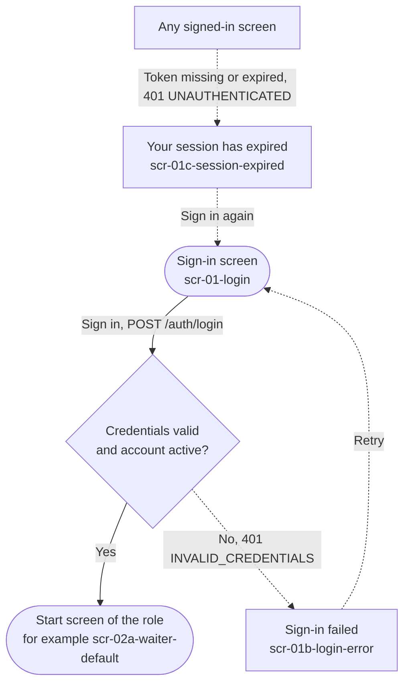
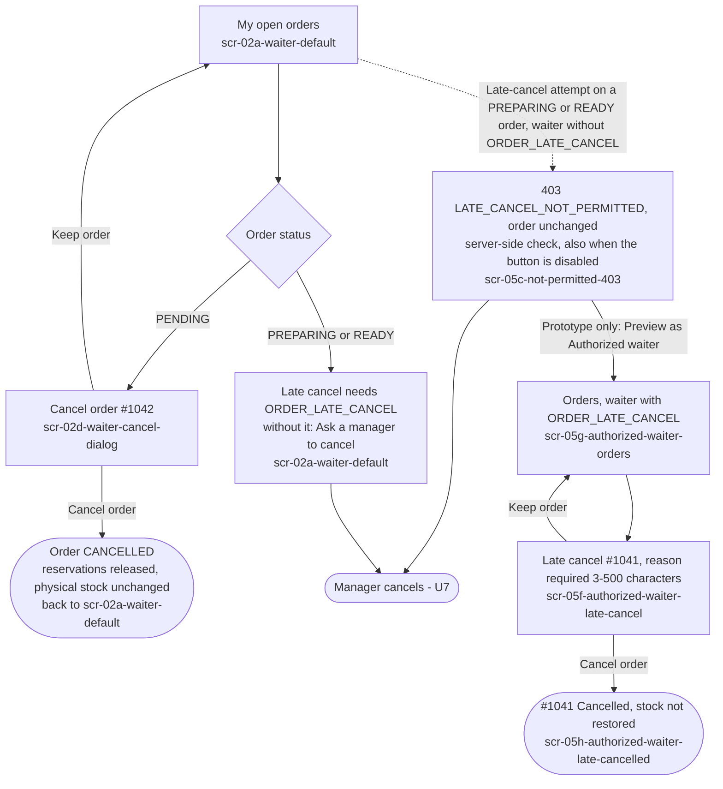
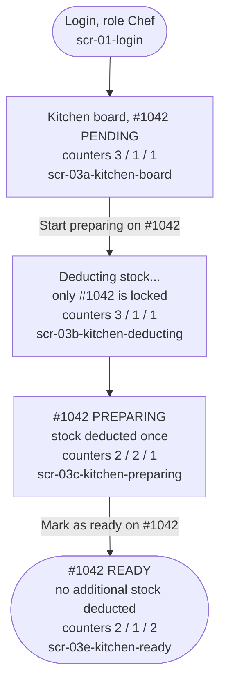
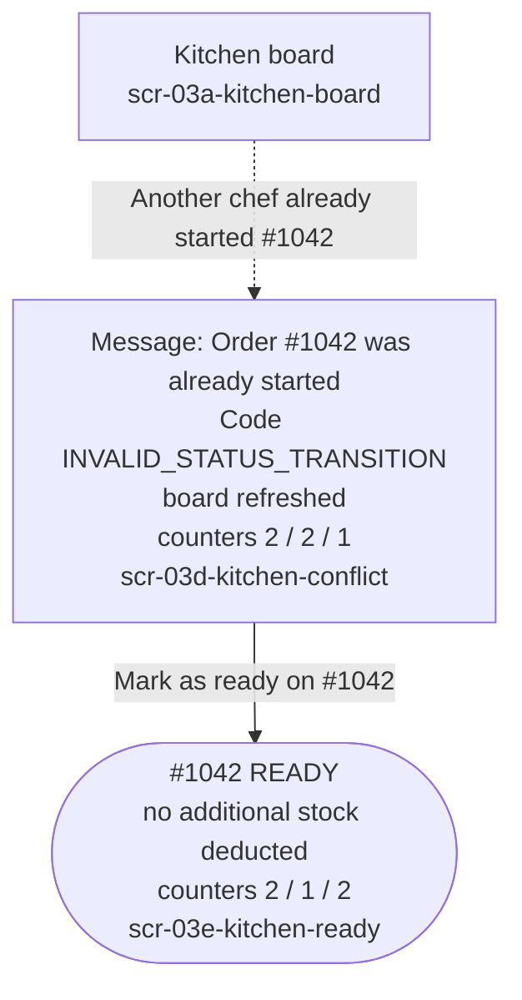
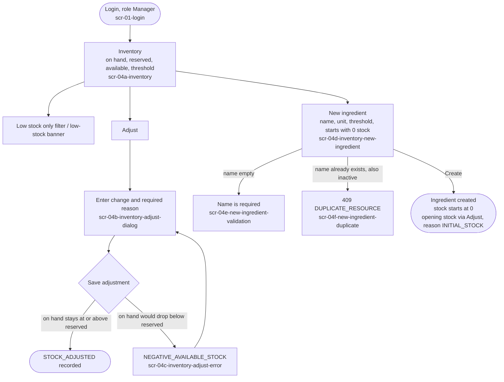
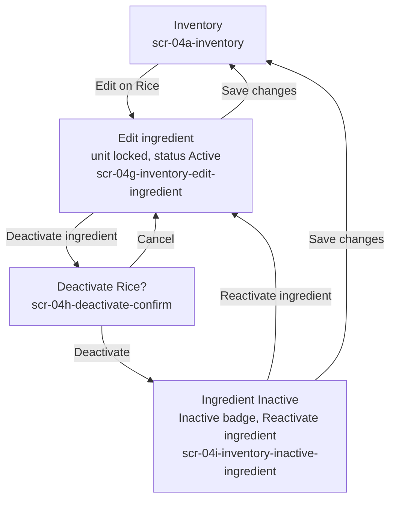
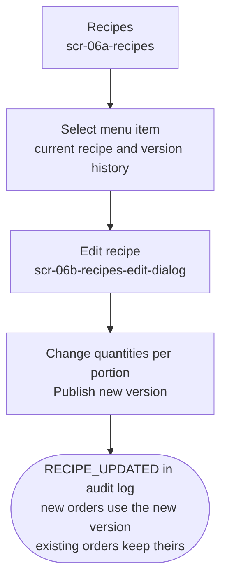
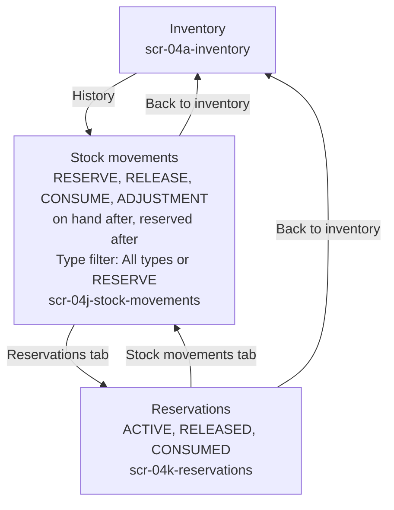
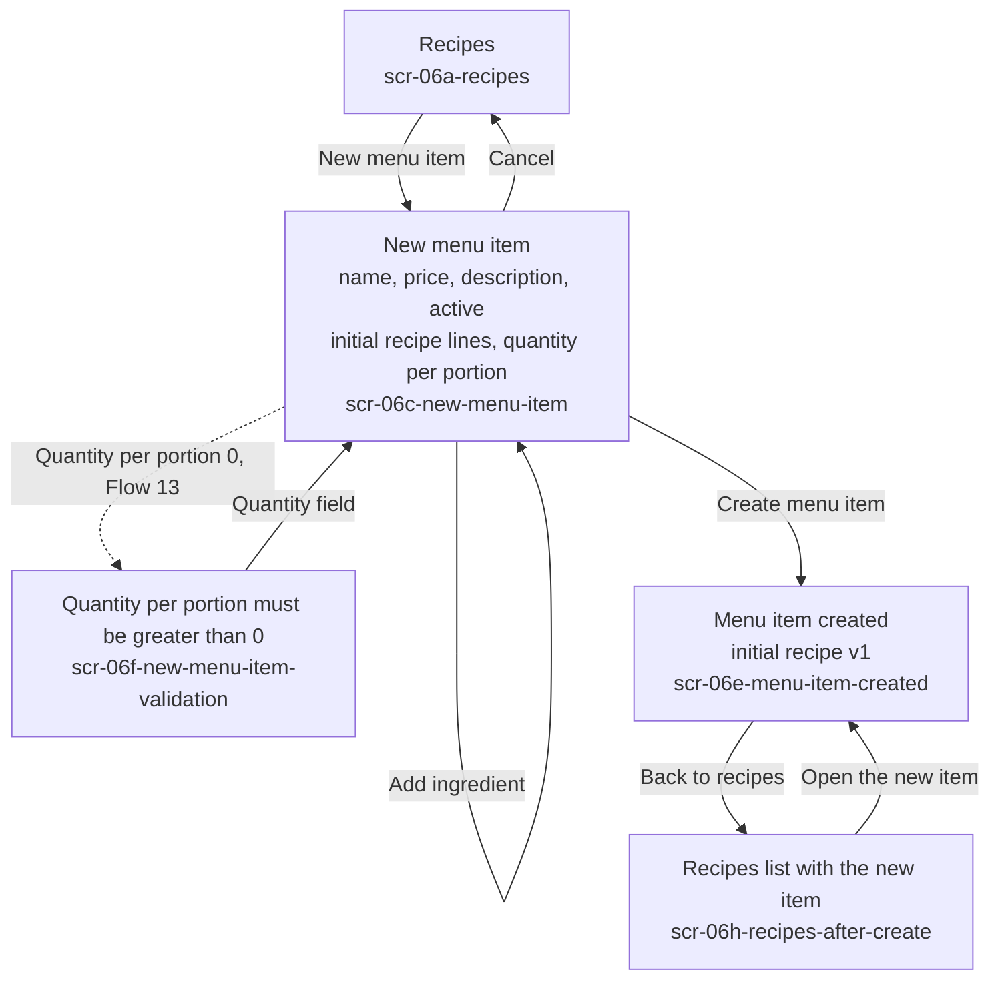
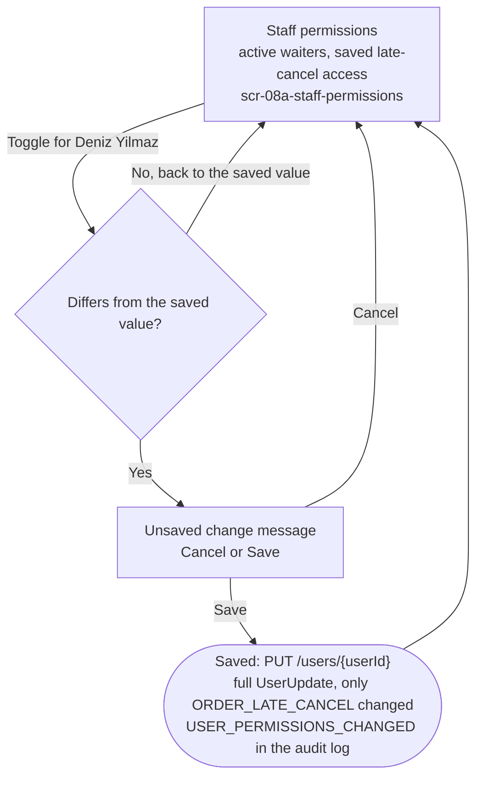

# PantryChef – User Flows

**Course:** BM321 – Software Engineering
**Sprint:** Sprint 2
**Task:** S2-30 – User-flow Diagrams
**Owner:** Tuğçe Çevik · **Reviewer:** Ayşe Dural
**Status:** Draft

Frame names (`scr-…`) are the Figma frame names listed in `docs/ui-ux/figma-links.md` (S2-33, merged into `develop` by [PR #71](https://github.com/seng321-7th-team/PantryChef/pull/71) on 20 Nov). Rules and error codes come from [`api/openapi.yaml`](../../api/openapi.yaml) (`develop`, version 0.2.0 since PR #62 was merged on 19 Nov; 0.2.1 since PR #91 on 20 Nov, wording only), the SRS and the refined backlog (merged in PR #54 and PR #55). Order flow: `PENDING` → `PREPARING` → `READY`. `CANCELLED` is terminal. There is no delivery feature.

Flows only cover what the 39 frames of the 20 Nov 2026 export show. Features that the User Stories require but the frames do not show are listed in `docs/ui-ux/ui-user-story-review.md` ([PR #50](https://github.com/seng321-7th-team/PantryChef/pull/50)) and are **not** drawn here.

## Flow list and Figma starting points

The numbers in this document (U1 to U12) are section numbers of this file. They are not the Figma flow numbers. The Figma flow starting points (13 in the 20 Nov export) are the ones in `docs/ui-ux/figma-links.md` ([PR #71](https://github.com/seng321-7th-team/PantryChef/pull/71)). The first nine Mermaid diagrams render on GitHub with their boxes, labels and arrows: U1, U1a, U2 and U5 to U8 checked on 18 November 2026 (unchanged since), U3 and U4 checked on 19 November 2026; result screenshots recorded. The U10 to U12 diagrams were added on 20 November 2026 and render on GitHub with their boxes, labels and arrows (checked at `81400e0` on 20 November 2026; result screenshots recorded). These checks cover diagram rendering only.

| Section | Flow | Figma flow starting point |
|---|---|---|
| U1 | Waiter creates an order | Flow 1 (login, role button Waiter) |
| U1a | Sign-in errors | Flow 1 starts at `scr-01-login`; `scr-01b` and `scr-01c` are drawn states (see U1a) |
| U2 | Waiter cancels, and late cancel | Flow 1 (login, role button Waiter), then Orders |
| U3 | Chef prepares an order | Flow 2 (`scr-03a-kitchen-board`), demo order #1042 |
| U4 | Chef: order already started, then Mark as ready | Flow 6: kitchen conflict (`scr-03d-kitchen-conflict`) |
| U5 | Manager manages inventory and creates an ingredient | Flow 3 (`scr-04a-inventory`) |
| U6 | Manager: ingredient lifecycle (edit, deactivate, reactivate) | Flow 9: ingredient lifecycle (`scr-04g-inventory-edit-ingredient`) |
| U7 | Manager cancels orders and reads the audit log | Flow 4 (`scr-05a-orders-and-audit`) |
| U8 | Manager edits a recipe | Flow 5 (`scr-06a-recipes`) |
| U9 | Common states | Flow 8: common states (`scr-07a-states`) |
| U10 | Manager inspects stock movements and reservations | Flow 11 - Inventory history (`scr-04j-stock-movements`) |
| U11 | Manager creates a menu item with its initial recipe | Flow 10 - New menu item and initial recipe (`scr-06c-new-menu-item`) |
| U12 | Manager grants or removes the late-cancel permission | Flow 12 - Staff late-cancel permissions (`scr-08a-staff-permissions`) |

Flow 7: duplicate ingredient (`scr-04f-new-ingredient-duplicate`) is part of U5. Flow 13 - New menu item: zero quantity error (`scr-06f-new-menu-item-validation`) is part of U11.

Some results are Figma variable states on the same frames, not separate frames (listed in `figma-links.md` section 2). The PDF and PNG exports show the start values only.

For the general demo, start at `scr-01-login` (Flow 1) and choose a role.

## U1 – Waiter creates an order (US-06, US-07)

Only the waiter creates orders in the prototype. There is no manager screen for this. SRS FR-06, backlog US-06 AC1 and API 0.2.0 (`createOrder`, "Roles: WAITER") restrict order creation to WAITER; all three are merged into `develop` (PR #54, #55, #62). ADR-006, including WAITER-only creation, is Accepted since [PR #87](https://github.com/seng321-7th-team/PantryChef/pull/87) was merged on 20 Nov. See `docs/ui-ux/ui-prototype.md` (merged by [PR #71](https://github.com/seng321-7th-team/PantryChef/pull/71)).

A dish that was closed to orders returns `422 MENU_ITEM_UNAVAILABLE` (state card in `scr-07a-states`).

**Retry after a network error:** "Send to kitchen" sends `POST /orders` with a required `Idempotency-Key`. A network error does not prove whether the server committed the request. Retrying the same logical order reuses the same key and body. If the first request completed and its result is stored, the server replays that result (`Idempotent-Replayed: true`); if no successful request was committed, the request can be processed once. Reusing a stored key with a different body returns `422 IDEMPOTENCY_KEY_REUSED`. A genuinely new order uses a new key. This rule is within the API's 24-hour key retention (`api/openapi.yaml`; ADR-005 in PR #64, Proposed). The connection-error card in `scr-07a-states` (U9) is drawn; the retry itself is not. Status requests may also use the optional key: a matching completed replay does not repeat effects; otherwise an invalid repeat transition returns `409 INVALID_STATUS_TRANSITION`.

## U1a – Sign-in errors (US-01)

`scr-01b-login-error` ("Sign-in failed", `INVALID_CREDENTIALS`) and `scr-01c-session-expired` ("Your session has expired", `UNAUTHENTICATED`) are drawn states. The dashed arrows show API behaviour (`POST /auth/login` returns `401` for wrong credentials or an inactive account; any protected request returns `401` when the token is missing, invalid or expired). This document does not rely on a clickable prototype link to or from these two frames. In the prototype, the role buttons on `scr-01-login` open the role screens without checking credentials.

## U2 – Waiter cancels, and late cancel (US-11, US-12, US-01)

Opening the Orders tab is allowed for waiters (`GET /orders`, roles MANAGER, CHEF, WAITER). `403 LATE_CANCEL_NOT_PERMITTED` comes only from a late-cancel request (`PATCH /orders/{orderId}/status` to `CANCELLED`) on a `PREPARING` or `READY` order by a waiter without `ORDER_LATE_CANCEL`. The same rule applies to both statuses: in `scr-05c-not-permitted-403` the Late cancel buttons of #1041 (Preparing) and #1039 (Ready) are disabled, and the banner shows the server's answer to such a request. The server checks the permission even if the request is sent anyway. In the prototype the Orders tab opens `scr-05c` directly; the diagram does not show a click on the disabled button (dashed arrow). A `PENDING` cancellation releases the reservations and leaves physical stock unchanged. Since the 20 Nov export, **Cancel order** in `scr-02d` returns to `scr-02a` with #1042 removed from "My open orders", and the manager list shows #1042 as `Cancelled` (Figma variable state; one prototype example, not a persisted backend result).

"Preview as" exists only in the prototype; in the real application the permission comes from the account.

## U3 – Chef prepares an order (US-08, US-09, US-10)

Prototype path for the demo order #1042. Counters are Pending / Preparing / Ready.

| | Clickable prototype | API behaviour (API 0.2.0 on `develop`) |
|---|---|---|
| Which orders | Demo interactions cover order #1042 only. Start preparing on #1040 and #1043 and Mark as ready on #1041 are drawn at 40% opacity and have no prototype connection. | Any `PENDING` order can be moved to `PREPARING` and any `PREPARING` order to `READY` by a chef (`PATCH /orders/{orderId}/status`). The #1042-only limit is not a product rule. |
| Start preparing | `scr-03a` → `scr-03b` → `scr-03c`. "Deducting stock…" is a simulated state; no backend call. | One transaction: `ACTIVE` reservations become `CONSUMED` and `onHand` is deducted once. A repeated request never deducts twice; an invalid transition returns `409 INVALID_STATUS_TRANSITION`. |
| Mark as ready | `scr-03c` → `scr-03e` | No stock movement. |
| Board refresh | The frames are static. | The board polls `GET /orders` every 15–30 seconds (team decision, ADR-010; O-01 in `ui-user-story-review.md`). |

Prototype navigation and displayed counters verified on 18 November 2026 for `scr-03a` → `scr-03b` → `scr-03c` → `scr-03e`; result screenshots recorded. This covers the prototype only, not stock changes, concurrency or idempotency.

## U4 – Chef: order already started (Figma Flow 6)

`scr-03d-kitchen-conflict` is a separate starting point (Flow 6). It is not linked from `scr-03a` on purpose; the dashed arrow is API behaviour: a second `PREPARING` request for an order that is no longer `PENDING` returns `409 INVALID_STATUS_TRANSITION` and the board is refreshed. In the prototype, Mark as ready on #1042 in `scr-03d` leads to `scr-03e-kitchen-ready`. Prototype navigation and displayed counters verified on 18 November 2026 for `scr-03d` → `scr-03e` (Ready result 2 / 1 / 2); result screenshots recorded.

## U5 – Manager manages inventory and creates an ingredient (US-02, US-03, US-04, US-14)

Since the 18 Nov re-export, `scr-04d` to `scr-04f` have no Initial stock field (helper text "Starts with 0 stock. Add stock using Adjust."). An ingredient is created with `onHand` 0 and the opening stock is entered as a separate adjustment with reason `INITIAL_STOCK`, as in SRS FR-02, backlog US-02 AC2–AC3 and API 0.2.0 (all merged; `initialQuantity` was removed in PR #62 at `866122e`). See D-9b in `ui-user-story-review.md`.

Prototype states since the 20 Nov export: **Save adjustment** for the Tomatoes example returns to `scr-04a` with on hand 14500, reserved 350 and available 14150; **Create** on `scr-04d` adds Bulgur with on hand, reserved and available 0, and **Adjust** on Bulgur opens the Adjust dialog with an `INITIAL_STOCK` opening-stock example. **History** on `scr-04a` opens U10.

## U6 – Manager: ingredient lifecycle (Figma Flow 9)

Follows API 0.2.0 (merged in PR #62).

Notes:

- **Deactivate and Reactivate are separate actions from Save changes.** In the prototype they change the state immediately. In the API they are their own requests (`DELETE /ingredients/{id}` soft delete returning `200`, or `PUT` with `active: true`).
- Edit never changes stock. Unit cannot be changed while the ingredient has stock or active reservations (`409 RESOURCE_IN_USE`).
- An inactive ingredient keeps history and existing pending orders, cannot be used in new recipes (`422 INGREDIENT_INACTIVE`), closes menu items that use it to new orders (`422 MENU_ITEM_UNAVAILABLE`, `availablePortions` 0), and raises no low-stock alert (SRS FR-14 since PR #89; API 0.2.0 `listLowStockAlerts`). Its stock stays visible and adjustable.
- Stock **Out** (available 0) and ingredient **Inactive** are different states.
- Audit (API 0.2.0): deactivation is recorded as `INGREDIENT_DEACTIVATED` and reactivation as `INGREDIENT_REACTIVATED`. No frame shows these audit entries (not drawn; API behaviour).

## U7 – Manager cancels orders and reads the audit log (US-11, US-12, US-13)

Since the 20 Nov export, **Cancel order** in `scr-05d` returns to `scr-05a` with #1042 shown as `Cancelled` (Figma variable state).

## U8 – Manager edits a recipe (US-05)

Not drawn (API behaviour, API 0.2.0): publishing a recipe version that uses an inactive ingredient is rejected with `422 INGREDIENT_INACTIVE`. No frame shows this error.

Since the 20 Nov export, **Publish v4** shows Menemen v4 with Olive oil 20 ml and keeps the v1–v3 history; existing orders keep their earlier versions (Figma variable state). **Cancel** keeps v3. **New menu item** on `scr-06a` opens U11.

## U9 – Common states (Figma Flow 8)

`scr-07a-states` is one static frame with six cards: loading, empty waiter orders, empty kitchen board, `500 INTERNAL_ERROR`, connection error and `422 MENU_ITEM_UNAVAILABLE`. It has no clickable path. For the retry rule behind the connection-error card, see U1.

## U10 – Manager inspects stock movements and reservations (US-13, Figma Flow 11)

Product-owner decision D-3 of 20 Nov ([PR #50 comment](https://github.com/seng321-7th-team/PantryChef/pull/50#issuecomment-7038140749)). Frames added in the 20 Nov export; team review pending.

API behaviour: `GET /inventory/movements` (MANAGER) and `GET /reservations` (MANAGER, CHEF). `RESERVE` and `RELEASE` change reserved stock only; `CONSUME` lowers on-hand and reserved stock; an `ADJUSTMENT` with reason `INITIAL_STOCK` records opening stock. A late cancellation creates no stock movement. Only the All types / RESERVE type filter is interactive in the prototype; the other filters show fixed sample values.

## U11 – Manager creates a menu item with its initial recipe (US-05, Figma Flow 10 and Flow 13)

Product-owner decision D-4 of 20 Nov. Frames added in the 20 Nov export; team review pending.

API behaviour: `POST /menu-items` (MANAGER) creates the menu item and its recipe together; the recipe starts at version 1, needs at least one line, uses each active ingredient once and needs a quantity greater than 0. In the prototype, **Add ingredient** adds an Olive oil line; fields use fixed sample values. `scr-06f` is a separate starting point (Flow 13), so the dashed arrow is not a click from `scr-06c`. Open API questions (name uniqueness, `409`, repeated ingredient line) are listed in `ui-user-story-review.md` section 7b.

## U12 – Manager grants or removes the late-cancel permission (US-01, US-12, Figma Flow 12)

Product-owner decision D-6 of 20 Nov. Frame added in the 20 Nov export; team review pending.

API behaviour: `PUT /users/{userId}` (MANAGER) replaces `fullName`, `role`, `permissions` and `active`, so the UI sends the current values and only adds or removes `ORDER_LATE_CANCEL`. Managers already have late-cancel access. In the prototype only Deniz Yilmaz can be selected (Elif Kaya cannot), and saving does not change the separate "Preview as" switch on the orders frames (U2). The diagram's audit and request labels are API behaviour, not a backend call made by the prototype.

## Role and screen overview

| Role | Screens |
|---|---|
| Waiter | New order, My open orders, Orders |
| Chef | Kitchen board |
| Manager | Inventory, Inventory history, Recipes, New menu item, Orders & audit, Staff permissions |

The manager screens share one menu: Inventory / Recipes / Orders & audit / Staff permissions.

## Current cross-document alignment

Update of 21 Nov, checked against `develop` at [`4227056`](https://github.com/seng321-7th-team/PantryChef/tree/4227056de2016b7523125b37a2368b6f78b390e2): SRS, refined backlog and API 0.2.1 are unchanged since `7270d63`. [PR #87](https://github.com/seng321-7th-team/PantryChef/pull/87) is merged: ADR-006 (including WAITER-only order creation) and ADR-008 are Accepted; ADR-005 remains Proposed. The schema ([PR #66](https://github.com/seng321-7th-team/PantryChef/pull/66)) is merged. The S2-33 documents and the 39-frame export ([PR #71](https://github.com/seng321-7th-team/PantryChef/pull/71)) and the S2-31 review ([PR #50](https://github.com/seng321-7th-team/PantryChef/pull/50)) are merged. The check of 20 Nov below is kept as recorded.

Check of 20 Nov against `develop` at [`7270d63`](https://github.com/seng321-7th-team/PantryChef/tree/7270d63c6d9e23b87ad46d2d0ea3f5153088af34): [SRS](https://github.com/seng321-7th-team/PantryChef/blob/7270d63c6d9e23b87ad46d2d0ea3f5153088af34/docs/srs.md) FR-01–FR-14 (PR #54), [refined backlog](https://github.com/seng321-7th-team/PantryChef/blob/7270d63c6d9e23b87ad46d2d0ea3f5153088af34/docs/product-backlog.md) US-01–US-14 (PR #55; US-15 and US-16 are P1, post-MVP) and [API 0.2.1](https://github.com/seng321-7th-team/PantryChef/blob/7270d63c6d9e23b87ad46d2d0ea3f5153088af34/api/openapi.yaml) with the C4/UML/ER diagrams (PR #62; wording update PR #91) are merged. SRS and backlog are unchanged since the previous check at `e197628`. SRS FR-14 states that deactivated ingredients raise no low-stock alerts (PR #89, merged). The ADR document (PR #64) and the consistency review (PR #68) are merged; ADR-005, ADR-006 (WAITER-only creation) and ADR-008 remain Proposed while [PR #87](https://github.com/seng321-7th-team/PantryChef/pull/87) is open. The schema ([PR #66](https://github.com/seng321-7th-team/PantryChef/pull/66)) is not merged. The earlier backlog wording "Waiter or Manager" (#55 at `beba8c6`) is recorded as F-07 in PR #50. U1 follows the waiter-only design.

The current FR/NFR mapping and the product-owner decisions are maintained in `docs/ui-ux/ui-user-story-review.md` (merged by [PR #50](https://github.com/seng321-7th-team/PantryChef/pull/50)). No backend/NFR pass is inferred from these diagrams.

## Not drawn (no frame)

"Show inactive" filter, editing or archiving an existing menu item, staff account management beyond the late-cancel permission. A manager order-creation screen is not drawn on purpose (waiter-only order creation). Stock movements and reservations (U10), new menu item with its first recipe (U11) and the late-cancel permission (U12) are drawn since the 20 Nov export.
