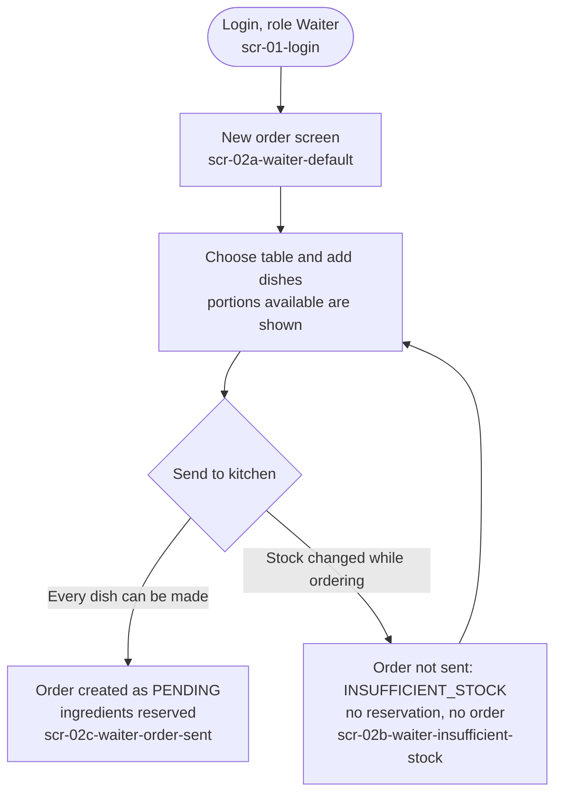
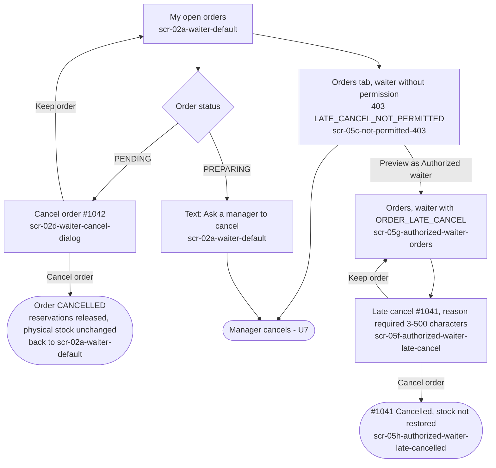
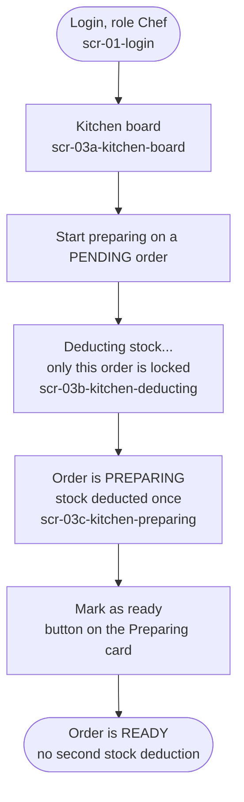
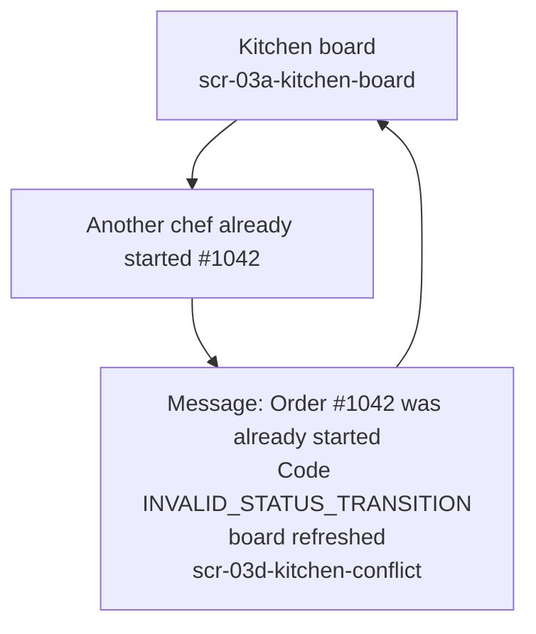
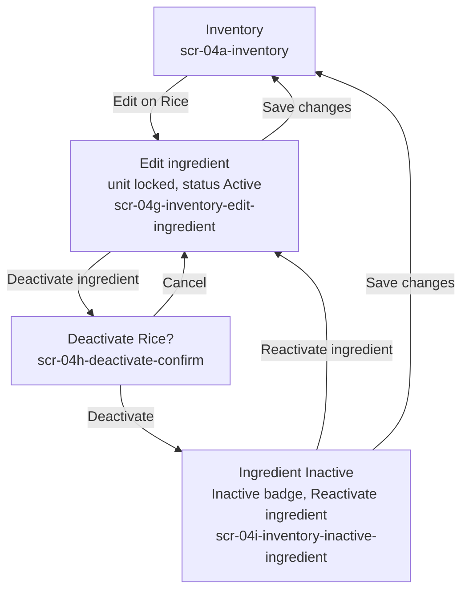
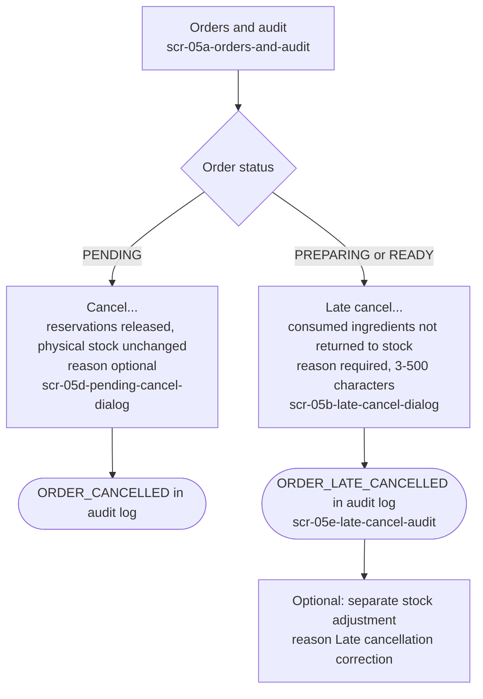
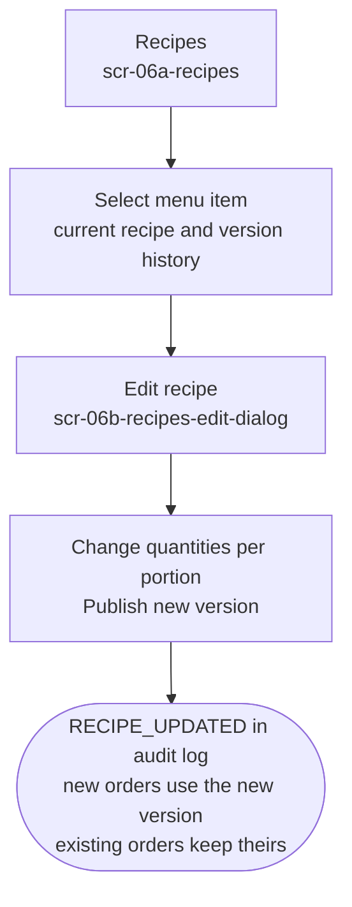

# PantryChef – User Flows

**Course:** BM321 – Software Engineering
**Sprint:** Sprint 2
**Task:** S2-30 – User-flow Diagrams
**Owner:** Tuğçe Çevik · **Reviewer:** Ayşe Dural
**Status:** Draft

Frame names (`scr-…`) are the Figma frame names listed in [`docs/ui-ux/figma-links.md`](https://github.com/seng321-7th-team/PantryChef/blob/1a9b1baae5627d7d6cfb16df42bd9b014a1cd916/docs/ui-ux/figma-links.md) (S2-33, PR #71, commit `1a9b1ba`; not on `develop` yet). Rules and error codes come from [`api/openapi.yaml`](../../api/openapi.yaml) (`develop`, version 0.1.0) and [`docs/product-backlog.md`](../product-backlog.md). Where a flow follows the API draft in PR #62 (head `cb634c3`, version 0.2.0, **not merged**; checked at `866122e`, and `api/openapi.yaml` is identical in `cb634c3`), the text says so. Order flow: `PENDING` → `PREPARING` → `READY`. `CANCELLED` is terminal. There is no delivery feature.

Flows only cover what the 31 frames show. Features that the User Stories require but the frames do not show are listed in [`ui-user-story-review.md`](https://github.com/seng321-7th-team/PantryChef/blob/7e4fbde08b14ae2198cc1b865dffe9ec5afe78b4/docs/ui-ux/ui-user-story-review.md) (PR #50, commit `7e4fbde`) and are **not** drawn here.

## Flow list and Figma starting points

The numbers in this document (U1 to U9) are section numbers of this file. They are not the Figma flow numbers. The Figma flow starting points are the ones in [`docs/ui-ux/figma-links.md`](https://github.com/seng321-7th-team/PantryChef/blob/1a9b1baae5627d7d6cfb16df42bd9b014a1cd916/docs/ui-ux/figma-links.md) (PR #71, commit `1a9b1ba`). The eight Mermaid diagrams in this file render on GitHub (checked by Codex on 18 Nov).

| Section | Flow | Figma flow starting point |
|---|---|---|
| U1 | Waiter creates an order | Flow 1 (login, role button Waiter) |
| U2 | Waiter cancels, and late cancel | Flow 1 (login, role button Waiter), then Orders |
| U3 | Chef prepares an order | Flow 2 (`scr-03a-kitchen-board`) |
| U4 | Chef: order already started | Flow 6: kitchen conflict (`scr-03d-kitchen-conflict`) |
| U5 | Manager manages inventory and creates an ingredient | Flow 3 (`scr-04a-inventory`) |
| U6 | Manager: ingredient lifecycle (edit, deactivate, reactivate) | Flow 9: ingredient lifecycle (`scr-04g-inventory-edit-ingredient`) |
| U7 | Manager cancels orders and reads the audit log | Flow 4 (`scr-05a-orders-and-audit`) |
| U8 | Manager edits a recipe | Flow 5 (`scr-06a-recipes`) |
| U9 | Common states | Flow 8: common states (`scr-07a-states`) |

Flow 7: duplicate ingredient (`scr-04f-new-ingredient-duplicate`) is part of U5.

For the general demo, start at `scr-01-login` (Flow 1) and choose a role.

## U1 – Waiter creates an order (US-06, US-07)

Only the waiter creates orders in the prototype. There is no manager screen for this. API draft #62 restricts `createOrder` to WAITER; `develop` (0.1.0) still lists WAITER and MANAGER (open item, see [`docs/ui-ux/ui-prototype.md`](https://github.com/seng321-7th-team/PantryChef/blob/1a9b1baae5627d7d6cfb16df42bd9b014a1cd916/docs/ui-ux/ui-prototype.md), PR #71, commit `1a9b1ba`).

A dish that was closed to orders returns `422 MENU_ITEM_UNAVAILABLE` (state card in `scr-07a-states`).

## U2 – Waiter cancels, and late cancel (US-11, US-12, US-01)

"Preview as" exists only in the prototype; in the real application the permission comes from the account.

## U3 – Chef prepares an order (US-08, US-09, US-10)

The "Mark as ready" button is visible on the Preparing cards (`scr-03a`, `scr-03c`). In the prototype it has no link to another frame; the READY result is described here from the Ready column on the board. The board says "Updates automatically"; the team decision is polling `GET /orders` every 15–30 seconds (O-01 in `ui-user-story-review.md`).

## U4 – Chef: order already started (Figma Flow 6)

This frame is a separate starting point. It is not linked from `scr-03a` on purpose.

## U5 – Manager manages inventory and creates an ingredient (US-02, US-03, US-04, US-14)

Since the 18 Nov re-export, `scr-04d` to `scr-04f` have no Initial stock field (helper text "Starts with 0 stock. Add stock using Adjust."). An ingredient is created with zero stock and the opening stock is entered with Adjust (reason `INITIAL_STOCK`), as in the SRS and backlog drafts and API draft #62 (`initialQuantity` removed in `866122e`; `api/openapi.yaml` unchanged in `cb634c3`). None of these drafts is merged (D-9b in `ui-user-story-review.md`).

## U6 – Manager: ingredient lifecycle (Figma Flow 9)

Follows API draft #62.

Notes:

- **Deactivate and Reactivate are separate actions from Save changes.** In the prototype they change the state immediately. In the API draft they are their own requests (`DELETE /ingredients/{id}` soft delete returning `200`, or `PUT` with `active: true`).
- Edit never changes stock. Unit cannot be changed while the ingredient has stock or active reservations (`409 RESOURCE_IN_USE`).
- An inactive ingredient keeps history and existing pending orders, cannot be used in new recipes (`422 INGREDIENT_INACTIVE`), closes menu items that use it to new orders (`422 MENU_ITEM_UNAVAILABLE`, `availablePortions` 0), and raises no low-stock alert. Its stock stays visible and adjustable.
- Stock **Out** (available 0) and ingredient **Inactive** are different states.

## U7 – Manager cancels orders and reads the audit log (US-11, US-12, US-13)

## U8 – Manager edits a recipe (US-05)

## U9 – Common states (Figma Flow 8)

`scr-07a-states` is one static frame with six cards: loading, empty waiter orders, empty kitchen board, `500 INTERNAL_ERROR`, connection error and `422 MENU_ITEM_UNAVAILABLE`. It has no clickable path.

## Role and screen overview

| Role | Screens |
|---|---|
| Waiter | New order, My open orders, Orders |
| Chef | Kitchen board |
| Manager | Inventory, Recipes, Orders & audit |

## Not drawn (no frame)

Stock movements and reservations view, new menu item with its first recipe, staff and permission management (granting the late-cancel permission), "Show inactive" filter. These depend on Burcu's decisions listed in `ui-user-story-review.md`. A manager order-creation screen is not drawn on purpose (waiter-only order creation).
